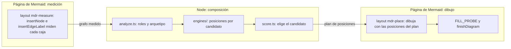

> **Revisión (2026-11-27).** Esta versión reemplaza la especificación recibida (commit
> `de16d9e`), tras revisarla contra el código de mdrender 2.18.0 y Mermaid 12.1.0. Los cambios
> y sus motivos están en el §11. Decisiones del autor del proyecto:
>
> 1. **Arquitectura A:** los motores de mdrender calculan las posiciones y **Mermaid dibuja**,
>    mediante un algoritmo de diagramación propio registrado con `mermaid.registerLayoutLoaders`.
>    Ya no se escribe un serializador de SVG propio.
> 2. **Solo `flowchart`/`graph`.** Los diagramas de estados quedan como trabajo posterior.
> 3. **El modo `ai` (antigua Fase 3) queda aplazado.** No se crea en esta fase. Al terminar el
>    modo `smart` se evaluará si basta con la interpretación determinista o si conviene alguna
>    opción con IA (§10).
>
> La ideación que dio origen a esta especificación está en
> [`IDEACION_DIAGRAMACION_MERMAID.md`](IDEACION_DIAGRAMACION_MERMAID.md). Los pasos de
> implementación están en la Fase 7 de [`PLAN_MAESTRO.md`](PLAN_MAESTRO.md).

## 1. Objetivo, alcance y garantías de diseño

Agregar a `mdrender` un modo de diagramación espacial para los bloques ` ```mermaid ` de tipo
diagrama de flujo. El modo reinterpreta la topología del grafo (espina dorsal, ciclos, nodos
transversales, subgrafos) y coloca los nodos con motores especializados en lugar del layout
jerárquico de un solo eje. El acabado visual actual y el modo de funcionamiento existente no
cambian.

### 1.1 Modos de operación

| Modo (`--mermaid-layout`) | Descripción                                                                                                                                                         | Por defecto | Red   |
| :------------------------ | :------------------------------------------------------------------------------------------------------------------------------------------------------------------ | :---------: | :---- |
| `classic`                 | El flujo vigente en 2.18.0: `mermaid.render()` + autofit (`mermaid-fit.ts`) + acabado (`mermaid-style.ts`). Sin ningún cambio.                                      |   **Sí**    | Nunca |
| `smart`                   | Motor reintérprete determinista y local: análisis del grafo, motores **serpentina**, **ciclo**, **hub bilateral**, **bento** y **ELK con puertos**; dibuja Mermaid. |     No      | Nunca |

### 1.2 Invariantes no negociables

1. **Retrocompatibilidad estricta.** Sin `--mermaid-layout`, o con `classic`, todas las salidas
   HTML y PDF y todas las pruebas actuales (`mermaid.test.ts`, `mermaid-autofit.test.ts`,
   `mermaid-style.test.ts`, `pdf.test.ts`…) dan exactamente el mismo resultado que hoy.
2. **Sin opciones a medio implementar.** `--mermaid-layout` acepta solo `classic` y `smart`. No
   aparece ninguna opción del modo `ai` en `--help`, en `VALIDATORS` ni en la documentación.
3. **PDF vectorial y tipografía incrustada.** Un diagrama dibujado en `smart` no introduce
   imágenes rasterizadas (en un PDF de prueba que solo tenga diagramas, `/Subtype /Image` = 0)
   ni filtros o sombras que obliguen a Chromium a rasterizar. Los textos usan la familia
   incrustada del documento (Manrope o Inter).
4. **Identidad visual unificada.** Como dibuja Mermaid con la misma configuración de tema, los
   diagramas en `smart` conservan formas, colores de todos los temas, estilos `classDef`,
   `style` y `linkStyle` del autor, y el acabado de `finishDiagram` (esquinas redondeadas,
   degradados con la opacidad en los `<stop>`, bandas de subgrafo). No se duplica ese código.
5. **Sin red.** El modo `smart` no hace ninguna petición. La página de Mermaid sigue con la red
   bloqueada (`restrictNetwork(page, false)`).
6. **Nunca peor que `classic`.** Si el modo `smart` no logra imprimir un diagrama al menos tan
   legible como lo haría `classic` (§5.3), o si falla por cualquier motivo, ese diagrama se
   dibuja con `classic`, sin interrumpir el documento.
7. **Ejecutable independiente.** Todo el código se empaqueta en `mdrender(.exe)` mediante
   `scripts/build-sea.mjs`, y sus licencias aparecen en `THIRD-PARTY-NOTICES.txt`.

### 1.3 Tipos de diagrama cubiertos

| Diagrama                                                                         | En modo `smart`       | Motivo                                                                                  |
| :------------------------------------------------------------------------------- | :-------------------- | :-------------------------------------------------------------------------------------- |
| `flowchart` / `graph` (`TB`, `TD`, `BT`, `LR`, `RL`)                             | **Reinterpretado**    | Núcleo del problema: 17 de los 20 casos de `tests/fixtures/mermaid-autofit.md`.         |
| `stateDiagram-v2`, `stateDiagram`                                                | `classic` (por ahora) | Sin corpus para calibrarlo; queda como trabajo posterior (§10).                         |
| `sequenceDiagram`, `classDiagram`, `erDiagram`, `gantt`, `pie`, `mindmap`, otros | `classic`             | Tienen una gramática visual posicional propia.                                          |
| Diagrama con `%%{init: …}%%` o `config:` del autor                               | `classic`             | Se respeta `authorConfigured()`, como hace hoy el autofit. Excepción: `%% @archetype:`. |
| Diagrama con elementos que el modo `smart` no sabe colocar                       | `classic`             | P. ej. aristas a un subgrafo anidado (§4.2); la medición lo detecta y delega.           |

## 2. Interfaz de línea de comandos, configuración y diagnósticos

### 2.1 Nueva opción

Se registra en `src/cli.ts` (`DOCUMENT_FLAGS` y `addDocumentOptions`, para `mdrender` y para
`mdrender preview`), en `src/options.ts` (`DocumentOptions`, `DEFAULT_OPTIONS`, `VALIDATORS`,
`OPTION_KEYS`) y en `mdrender.config.json`:

| Opción CLI                | Front matter / JSON                | Valores            | Por defecto | Descripción                                              |
| :------------------------ | :--------------------------------- | :----------------- | :---------: | :------------------------------------------------------- |
| `--mermaid-layout <mode>` | `mermaid-layout` / `mermaidLayout` | `classic`, `smart` |  `classic`  | Motor de composición espacial de los diagramas de flujo. |

### 2.2 Precedencia e interacción con las opciones existentes

1. **Prioridad:** la de siempre, `CLI > front matter > mdrender.config.json > THEME_DEFAULTS >
DEFAULT_OPTIONS`. Como `smart` no usa la red, no hace falta ninguna compuerta especial.
2. **`--no-mermaid-autofit`:** en `classic`, como hoy. En `smart`, una sola pasada del
   arquetipo elegido con el ancho de ajuste por defecto de Mermaid, sin búsqueda de candidatos.
3. **`--mermaid-flip never`:** en `smart`, los motores no cambian el eje global escrito por el
   autor (no transponen un `bento` o un `layered` de `LR` a `TB`). Sí pueden plegar una cadena
   `LR` en serpentina, que sigue leyéndose de izquierda a derecha.
4. **`--mermaid-theme` y los temas de página:** sin cambios; el modo `smart` usa la misma
   configuración de Mermaid que `classic` (tema, variables, `themeCSS`, fuente).
5. **`--verbose`** (`describeLayout` en `src/convert.ts`):
   - `classic`: sin cambios (`Mermaid autofit: wrap 300, turned LR→TB, scale 0.33 → 1.00…`).
   - `smart`: `Mermaid smart layout: archetype serpentine (3×3), sidecars [DB], scale 0.37 → 1.00, height 81 → 312 px (4 candidates tried)`.
   - Diagrama que vuelve a `classic`: `Mermaid smart layout: kept classic (<motivo>)`.
6. **`mdrender doctor`** (`src/doctor.ts`): en el check `Settings`, agregar
   `, mermaid layout smart` cuando la configuración efectiva no sea `classic`.

## 3. Arquitectura

### 3.1 Idea central: Mermaid dibuja, mdrender coloca

Mermaid 12 permite registrar algoritmos de diagramación propios con
`mermaid.registerLayoutLoaders([{ name, loader }])` y elegirlos con la opción `layout`. Mermaid
analiza el diagrama, prepara los nodos y aristas (`LayoutData`) y llama a la función `render`
del algoritmo con funciones de dibujo: `insertNode`, `insertCluster`, `insertEdge`,
`insertEdgeLabel`, `positionEdgeLabel`, `insertMarkers`. El algoritmo decide las coordenadas y
usa esas funciones para dibujar. Después Mermaid ajusta el `viewBox` como siempre.

Se comprobó en Chromium con Mermaid 12.1.0: una cadena de 8 pasos plegada en serpentina,
dibujada por Mermaid con el tema Anti-Gravity, flechas incluidas, y con `finishDiagram`
aplicado sin cambios. Pasó de 1512×103 px a 572×386 px.

Los motores se escriben en TypeScript y corren **en Node**, como funciones puras que se prueban
sin navegador. La página solo mide y dibuja. Por eso cada diagrama pasa por la página dos
veces:



1. **Medición** (`mdr-measure`). En la página que ya abre `renderMermaid`, con las fuentes del
   documento cargadas, se renderiza el diagrama con el layout `mdr-measure`. Su `render` llama
   a `insertNode` para cada nodo, a `insertEdgeLabel` para cada etiqueta de arista y a
   `insertCluster` para cada subgrafo. Así obtiene los tamaños reales que Mermaid dará a cada
   forma, guarda el grafo medido en una variable global de la página y no dibuja nada útil. Se
   repite una vez por ancho de ajuste candidato.
2. **Composición** (Node). El grafo medido se convierte en el IR (§4.1). `analyze.ts` le asigna
   roles y arquetipo, los motores calculan las posiciones de cada candidato y `score.ts` los
   puntúa con las dimensiones calculadas, **sin volver a dibujar**.
3. **Dibujo** (`mdr-place`). El plan ganador (centros de nodos, rectángulos de subgrafos,
   puntos de cada arista) se pasa a la página como datos, como argumento de `page.evaluate`
   (nunca concatenado en código). El layout `mdr-place` dibuja con las funciones de Mermaid en
   esas posiciones. El SVG resultante sigue el camino de hoy: `FILL_PROBE` y `finishDiagram`.

El código de los dos layouts de página se pasa como texto fuente, igual que hoy `FILL_PROBE`,
sin paso de compilación. Debe ser corto: medir y dibujar, nada más.

### 3.2 Bifurcación en `renderMermaid`

Para cada bloque, `src/render/mermaid.ts` hace lo de hoy y, si corresponde, prueba `smart`:

1. Renderiza con `classic`, con autofit si está activo, como hoy. Ese resultado es el **piso**.
2. Si el modo es `smart`, el diagrama es un `flowchart`/`graph` y no está configurado por el
   autor (o trae `%% @archetype:`), llama a `composeDiagram()`.
3. Si `composeDiagram()` devuelve un SVG que cumple el piso (§5.3), se usa ese; si no, se usa el
   de `classic`, con la nota correspondiente en `--verbose`.

Los dos layouts se registran una sola vez por página. Los nombres `mdr-measure` y `mdr-place`
no chocan con los de Mermaid (`dagre`, `elk`, `swimlane`…).

### 3.3 Mapa de archivos

| Archivo                                                           | Tipo       | Responsabilidad                                                                                                            |
| :---------------------------------------------------------------- | :--------- | :------------------------------------------------------------------------------------------------------------------------- |
| `src/options.ts`, `src/cli.ts`, `src/convert.ts`, `src/doctor.ts` | Modificado | Opción `--mermaid-layout <classic\|smart>`, trazas de `--verbose` y `doctor`.                                              |
| `src/render/mermaid.ts`                                           | Modificado | Registro de los layouts de página y bifurcación por bloque (§3.2).                                                         |
| `src/render/mermaid-compose/types.ts`                             | Nuevo      | Tipos puros: `MeasuredGraph`, `AnalyzedGraph`, `LayoutPlan`.                                                               |
| `src/render/mermaid-compose/directives.ts`                        | Nuevo      | Lectura de las pistas `%% @archetype:`, `%% @sidecar:`, `%% @spine:` del texto del diagrama.                               |
| `src/render/mermaid-compose/page-layouts.ts`                      | Nuevo      | Texto fuente de los layouts `mdr-measure` y `mdr-place` que corren en la página.                                           |
| `src/render/mermaid-compose/analyze.ts`                           | Nuevo      | Ciclos (Tarjan), espina dorsal, nodos transversales, polaridad de decisiones y elección de arquetipo.                      |
| `src/render/mermaid-compose/engines/serpentine.ts`                | Nuevo      | Plegado en S con conectores en U.                                                                                          |
| `src/render/mermaid-compose/engines/flywheel.ts`                  | Nuevo      | Ciclos cerrados de 3 a 8 nodos sobre una elipse.                                                                           |
| `src/render/mermaid-compose/engines/hub.ts`                       | Nuevo      | Hub con dos alas equilibradas (oeste y este).                                                                              |
| `src/render/mermaid-compose/engines/bento.ts`                     | Nuevo      | Subgrafos en retícula con anchos y altos igualados.                                                                        |
| `src/render/mermaid-compose/engines/layered.ts`                   | Nuevo      | Caso general: `elkjs` en Node con puertos fijos y zócalo para los nodos transversales.                                     |
| `src/render/mermaid-compose/routing.ts`                           | Nuevo      | Puntos de cada arista (rutas ortogonales, arcos del ciclo, retornos por un canal lateral).                                 |
| `src/render/mermaid-compose/polish.ts`                            | Nuevo      | Ajuste a una retícula de 8 px y centrado.                                                                                  |
| `src/render/mermaid-compose/score.ts`                             | Nuevo      | Puntuación de candidatos (§5.2).                                                                                           |
| `src/render/mermaid-compose/index.ts`                             | Nuevo      | `composeDiagram()`: medición, análisis, motores, puntuación y dibujo; devuelve el SVG o el motivo para volver a `classic`. |

### 3.4 Dependencias y licencias

- **`elkjs` (0.9.3, EPL-2.0)** se agrega como dependencia directa para `engines/layered.ts`, con
  `elkjs/lib/elk.bundled.js` (JavaScript puro, sin Web Workers; se comprobó que corre en Node).
  Ya está en `package-lock.json` como dependencia de `mermaid` y ya aparece en
  `THIRD-PARTY-NOTICES.txt`. La copia de ELK que trae `mermaid.min.js` no está expuesta y no se
  puede usar desde el layout propio.
- **Versión de Mermaid.** Los layouts propios dependen de las funciones de dibujo que Mermaid
  pasa al algoritmo, que no tienen garantía de estabilidad. `package.json` declara hoy
  `"mermaid": "^12.1.0"`, que acepta versiones menores nuevas. Se fija la versión exacta y se
  agregan pruebas de contrato (`mermaid-layout-contract.test.ts`, §7.1); toda actualización de Mermaid pasa por ellas.

### 3.5 Compatibilidad con estilos futuros

Como Mermaid dibuja, el modo `smart` funciona también con los aspectos `look: handDrawn` y
`neo`, y con los estilos de diagrama propuestos en
[`IDEAS_ESTILOS_MERMAID.md`](IDEAS_ESTILOS_MERMAID.md). Los tamaños de las formas cambian con el
aspecto; como se miden en la misma página, el plan sigue siendo correcto.

## 4. Grafo medido, pistas y análisis

### 4.1 Grafo medido (`types.ts`)

El layout `mdr-measure` devuelve, a partir del `LayoutData` de Mermaid:

```ts
export interface MeasuredNode {
  id: string; // id de Mermaid
  label: string; // texto, para las reglas léxicas
  shape: string; // nombre de forma de Mermaid: "squareRect", "diamond", "cylinder", "cyl", "stadium"…
  parentId?: string; // subgrafo que lo contiene
  order: number; // orden de aparición en la fuente
  width: number; // tamaño que le da insertNode, en px
  height: number;
}

export interface MeasuredEdge {
  id: string; // "L_A_B_0"
  from: string;
  to: string;
  label?: string;
  labelSize?: { width: number; height: number };
  pattern: "normal" | "dotted" | "thick" | "invisible";
  minlen: number; // 1 para -->, 2 para --->, …
  order: number;
}

export interface MeasuredCluster {
  id: string;
  title: string;
  titleSize: { width: number; height: number };
  parentId?: string;
  dir?: "TB" | "BT" | "LR" | "RL";
  order: number;
}

export interface MeasuredGraph {
  direction: "TB" | "BT" | "LR" | "RL";
  wrap: number | undefined; // ancho de ajuste con que se midió
  nodes: MeasuredNode[];
  edges: MeasuredEdge[];
  clusters: MeasuredCluster[];
}
```

Las formas se agrupan con funciones auxiliares, porque Mermaid tiene alias (por ejemplo,
`[(…)]` da `cylinder` y `@{ shape: cyl }` da `cyl`): `isDecisionShape`, `isStorageShape`.

`LayoutPlan` es lo que vuelve a la página: el centro de cada nodo; el rectángulo de cada
subgrafo; los puntos de cada arista, con su interpolación; la dirección efectiva.

### 4.2 Lo que no se reinterpreta

La medición devuelve `fallback` (y el diagrama se dibuja con `classic`) si encuentra:

- aristas que salen de un subgrafo anidado o llegan a él. Las aristas entre subgrafos de primer
  nivel, o entre un nodo y uno de ellos (como `Entrada --> Salida` en el caso 8 de
  `mermaid-autofit.md`), sí se admiten: el motor `bento` las une por el borde de los
  subgrafos, y `insertEdge` las recorta contra ese borde con el registro de subgrafos que
  recibe (`clusterDb`), como hace el layout `dagre` de Mermaid. Se confirma en la prueba de
  concepto (paso 7.1 del plan);
- subgrafos anidados a más de dos niveles;
- más de 60 nodos (límite inicial, ajustable con `bench:mermaid`);
- cualquier dato que no tenga la forma esperada (señal de un cambio en Mermaid).

### 4.3 Pistas opcionales en comentarios (`directives.ts`)

Comentarios de Mermaid, ignorados por cualquier otro visor:

- `%% @archetype: serpentine | flywheel | hub | bento | layered`
- `%% @sidecar: ID1, ID2`
- `%% @spine: A -> B -> C -> D`

Si están presentes, mandan sobre la heurística. Los IDs que no existan en el grafo se ignoran,
con un aviso en `--verbose`.

### 4.4 Analizador (`analyze.ts`)

Sobre el grafo medido, ignorando las aristas `invisible` para la conectividad pero conservando
su orden, cinco pasos puros. Todos los umbrales de esta sección son **valores iniciales**: se
calibran con el corpus (§7) y quedan como constantes con nombre, como en `mermaid-fit.ts`.

1. **Ciclos.** Tarjan para las componentes fuertemente conexas, y DFS desde las entradas
   (grado de entrada 0, o el nodo de menor `order` si todo el grafo es cíclico) para marcar
   como `feedback` las aristas de retorno.
2. **Nodos transversales (`sidecar`).** Con la profundidad topológica sobre el grafo sin
   aristas `feedback`, un nodo es `sidecar` si cumple las dos condiciones:
   - recibe aristas de al menos 3 nodos situados en al menos 2 profundidades distintas;
   - es un sumidero, o solo alimenta a un nodo hoja (como `LOG --> DASH` en el caso 15 de
     `mermaid-autofit.md`), o tiene forma de almacenamiento, o su etiqueta coincide (sin
     distinguir mayúsculas ni acentos) con el vocabulario de infraestructura: `db`, `database`,
     `postgres`, `sql`, `redis`, `cache`, `buffer`, `log`, `logs`, `metricas`, `metrics`,
     `telemetria`, `audit`, `storage`, `s3`, `bus`, `queue`, `checkpoint`, `checkpoints`.

   Nunca es `sidecar` un vértice de articulación cuya eliminación desconecte las fuentes de
   los sumideros principales. Las aristas que llegan a un `sidecar` se marcan `infra`.

3. **Espina dorsal.** Sin los `sidecar` ni las aristas `feedback`, el camino dirigido más largo
   de una fuente a un sumidero, desempatando por aristas no negativas y por menor `order`. Sus
   nodos son `spine` (los extremos, `entry` y `sink`) y sus aristas, `primary`.
4. **Decisiones y excepciones.** Son `decision` los nodos con forma de rombo, los que terminan
   en `?`, y los de grado de salida ≥ 2 cuyas aristas tienen etiquetas cortas (≤ 18
   caracteres). Sus salidas se clasifican por la etiqueta:
   - `positive`: `/^(s[ií]|yes|ok|true|v[aá]lido|éxito|pass|1|gana|promover)\b/i`
   - `negative`: `/^(no|error|fail|fallo|false|inv[aá]lido|reject|timeout|0|descartar)\b/i`

   Las hojas a las que solo llegan aristas `negative` o punteadas (como
   `R -. desactivación .-> X` en `examples/articulo-academico.md`) son `error`.

5. **Arquetipo.** Sea _N_ el número de nodos sin los `sidecar` y _K_ el de subgrafos de primer
   nivel:

   | Prioridad | Arquetipo        | Regla                                                                                                                                              |
   | :-------: | :--------------- | :------------------------------------------------------------------------------------------------------------------------------------------------- |
   |     1     | _(Pista)_        | `%% @archetype: <nombre>` en el bloque.                                                                                                            |
   |     2     | **`bento`**      | _K_ ≥ 2 subgrafos de primer nivel que reúnen al menos el 60 % de los nodos.                                                                        |
   |     3     | **`flywheel`**   | Una sola componente cíclica de 3 a 8 nodos con al menos el 65 % de los nodos y grado medio interno ≤ 2,4 (admite una entrada previa y una salida). |
   |     4     | **`serpentine`** | _K_ = 0, _N_ ≥ 5, espina dorsal ≥ 0,75·_N_, a lo sumo una hoja lateral por nodo y sin ciclos de más de 2 pasos.                                    |
   |     5     | **`hub`**        | _K_ = 0, _N_ ≥ 5 y un nodo con grado ≥ máx(4, ⌈0,55·(_N_ − 1)⌉) cuya eliminación deja ≥ 4 componentes de ≤ 2 nodos.                                |
   |     6     | **`layered`**    | Cualquier otro grafo (DAG general, árboles profundos, ciclos acoplados como MCTS o Gumbel).                                                        |

## 5. Motores, rutas y elección

### 5.1 Motores (`engines/`)

Todos son funciones puras `(grafo analizado, opciones) => LayoutPlan`. Las posiciones son
centros de nodo; los tamaños vienen medidos y no se cambian.

1. **`serpentine`.** Prueba 2 a 5 columnas por fila (menos que la longitud de la espina). Las
   filas pares van de izquierda a derecha y las impares de derecha a izquierda. Alinea los
   centros por columna y por fila. El cambio de fila es una arista vertical en la columna del
   extremo. Las hojas laterales (`branch`, `error`) van debajo de su nodo padre.
2. **`flywheel`.** Los _k_ nodos del ciclo, en sentido horario desde las 12:
   θᵢ = −π/2 + 2πi/_k_; xᵢ = cₓ + Rₓ·cos θᵢ; yᵢ = c_y + R_y·sen θᵢ. Rₓ y R_y se calculan para
   dejar al menos 36 px entre cajas vecinas, con Rₓ/R_y entre 1,0 y 1,45. Las aristas del anillo
   son arcos (varios puntos sobre la elipse); la entrada y la salida externas, horizontales.
3. **`hub`.** El hub en el centro. Las ramas se reparten en un ala oeste y un ala este de altura
   parecida: entradas al oeste y salidas al este cuando hay de las dos; mitad y mitad cuando
   todas van en el mismo sentido (como las 6 aperturas del caso 9 de `mermaid-autofit.md`).
4. **`bento`.** Primero el layout interno de cada subgrafo (con su `direction` o la global) y
   luego la retícula de subgrafos: los apilados en una columna igualan su ancho exterior al
   mayor; los que están en una misma fila igualan su alto. Cada subgrafo reserva arriba el
   alto de su título más `SUBGRAPH_TITLE_MARGIN`, para la banda de `addClusterHeads()`.
5. **`layered`.** `elkjs` en Node sobre el grafo sin los `sidecar`, con
   `elk.portConstraints: FIXED_SIDE`. En `TB`, el flujo principal entra por el norte y sale por
   el sur; las ramas `negative` salen por el este o el oeste; las aristas `feedback` salen por el
   este y vuelven por un canal lateral. En `LR`, lo mismo girado. Después se colocan los
   `sidecar` en un zócalo inferior (flujo `LR`) o un carril derecho (flujo `TB`), alineados con
   el baricentro de los nodos que los usan, y sus aristas `infra` llegan agrupadas.

### 5.2 Rutas (`routing.ts`) y pulido (`polish.ts`)

- **Rutas.** Cada arista es una lista de puntos que Mermaid recorta contra el borde de cada
  forma y dibuja con su flecha. Rutas ortogonales con esquinas suavizadas: interpolación
  `rounded` de Mermaid (`flowchart.curve`). Los arcos del ciclo, con varios puntos y una
  interpolación suave. Si Mermaid permite la interpolación por arista (`edge.curve`), cada motor
  elige la suya; si no, una para todo el diagrama (se confirma en la prueba de concepto, paso 7.1 del plan).
- **Etiquetas de arista.** `positionEdgeLabel` las pone en el punto medio del recorrido; el
  router elige un tramo recto libre y, si la etiqueta choca con un nodo, desplaza el tramo.
- **Pulido.** Centros alineados a múltiplos de 8 px y centrado del conjunto.
- **Fuera de esta fase:** puentes en los cruces inevitables (_line hops_) e igualar el tamaño
  de nodos hermanos. Lo primero se puede hacer después como retoque del SVG, igual que
  `finishDiagram`; lo segundo depende de que Mermaid respete un tamaño dado, a verificar.

### 5.3 Elección del candidato (`score.ts`)

Con autofit, para cada ancho de ajuste candidato (inicialmente el de Mermaid, 200 y 300 px; se
calibra con `bench:mermaid`) y, si `flip` es `auto`, para el eje transpuesto en los arquetipos
con eje, se calcula el plan y su puntuación **en Node**, a partir de las dimensiones del plan:

U(c) = 100·S(c) − 12·|ln((W_c/H_c)/R)| − 4·Cruces(c) − 6·Desbalance(c)

- _S(c)_ es la escala impresa, igual que en `mermaid-fit.ts`: el mínimo entre 1, el ancho de la
  columna dividido por _W_c_ y el alto disponible dividido por _H_c_.
- _R_ es la proporción del espacio disponible (ancho de columna / alto de página).

Solo el candidato de mayor _U_ se dibuja. Después se mide su SVG real con `candidate()` de
`mermaid-fit.ts` y se compara con el resultado de `classic` (el piso). El candidato `smart` se
usa solo si su escala impresa es al menos la de `classic` menos `SCALE_TOLERANCE` (0,05). Si no,
se queda el de `classic`, con su motivo en `--verbose`.

## 6. Contrato con el resto del pipeline

El SVG de `smart` lo produce `mermaid.render()`, así que ya cumple lo que esperan `theme.css`,
`FIGURE_FIT` (`src/render/browser.ts`), `measureSvg()` (`src/render/mermaid-fit.ts`) y
`finishDiagram()` (`src/render/mermaid-style.ts`): raíz `<svg>` con `viewBox`, `width="100%"`
y `max-width`; nodos con `.label-container`; subgrafos `g.cluster` con su `rect` y su
`.cluster-label`. La prueba de concepto y las pruebas de integración lo verifican; no hace
falta reproducirlo a mano.

## 7. Pruebas y criterios de aceptación

### 7.1 Pruebas

| Archivo de prueba                                                    | Qué verifica                                                                                                                                                                                                                                                                                | Navegador |
| :------------------------------------------------------------------- | :------------------------------------------------------------------------------------------------------------------------------------------------------------------------------------------------------------------------------------------------------------------------------------------ | :-------: |
| `tests/options.test.ts`, `tests/cli.test.ts`, `tests/doctor.test.ts` | `--mermaid-layout <classic\|smart>`: validación, prioridad de capas, rechazo de valores desconocidos con código 1, sugerencia ante errores de tipeo, línea en `doctor`.                                                                                                                     |    No     |
| `tests/mermaid-analyze.test.ts` _(nuevo)_                            | Ciclos, espina dorsal, `sidecar` (incluida la exclusión de vértices de articulación), polaridad, los cinco arquetipos y las pistas `%% @…`.                                                                                                                                                 |    No     |
| `tests/mermaid-engines.test.ts` _(nuevo)_                            | Sin solapes de cajas ni de etiquetas en los cinco motores; anchos iguales en `bento`; alas equilibradas en `hub`; retícula de 8 px.                                                                                                                                                         |    No     |
| `tests/mermaid-layout-contract.test.ts` _(nuevo)_                    | Contrato con Mermaid: `registerLayoutLoaders` existe; `mdr-measure` devuelve tamaños para todas las formas del corpus; `mdr-place` dibuja nodos, subgrafos, aristas y marcadores donde dice el plan. Falla si una versión nueva de Mermaid lo rompe.                                        |    Sí     |
| `tests/mermaid-smart.test.ts` _(nuevo)_                              | Conversión a HTML y PDF con `--mermaid-layout smart` en `antigravity`, `antigravity-dark`, `academic_basic` y `tech_magazine`: texto extraíble, sin imágenes, degradados y `cluster-head` presentes, vuelta a `classic` para `sequenceDiagram`, `pie`, `stateDiagram` y los casos del §4.2. |    Sí     |

### 7.2 Criterios de aceptación

1. Sin `--mermaid-layout`, `npm run check` pasa sin tocar ninguna aserción existente, con la
   cobertura que exige `vitest.config.ts` (líneas, funciones y sentencias ≥ 80 %; ramas ≥ 70 %).
2. Con `--mermaid-layout smart`, sobre `tests/fixtures/mermaid-autofit.md` y el nuevo
   `tests/fixtures/mermaid-smart.md`:
   - ningún diagrama se imprime con menor escala que en `classic` (menos la tolerancia);
   - las cadenas lineales de 6 o más pasos se pliegan en serpentina y ocupan menos alto
     impreso que en `classic` (el objetivo inicial, a confirmar en la prueba de concepto, es
     un 35 % menos);
   - los subgrafos apilados en `bento` tienen exactamente el mismo ancho en el SVG;
   - los nodos `sidecar` (`DB`, `LOG`) quedan en su zócalo sin atravesar nodos del flujo
     principal.
3. Un documento con 50 diagramas en `smart` tarda como mucho el doble que en `classic`.
4. `npm run build:exe` empaqueta `mdrender(.exe)` con `elkjs` y convierte un `.md` con
   `--mermaid-layout smart` fuera del repositorio, en Windows y en Linux (CI).

## 8. Plan de ejecución

Los pasos, con su tamaño y dependencias, están en la **Fase 7** de
[`PLAN_MAESTRO.md`](PLAN_MAESTRO.md). Resumen:

| Paso | Contenido                                                                                     |
| :--: | :-------------------------------------------------------------------------------------------- |
| 7.1  | Prueba de concepto de los layouts de página: contrato con Mermaid y puntos abiertos del §5.2. |
| 7.2  | Opción `--mermaid-layout`, versión fija de Mermaid y `elkjs`.                                 |
| 7.3  | Medición, IR, pistas y dibujo (`mdr-measure`, `mdr-place`), con vuelta a `classic`.           |
| 7.4  | Analizador.                                                                                   |
| 7.5  | Motores `serpentine`, `flywheel`, `hub`, `bento` y pulido.                                    |
| 7.6  | Motor `layered` con `elkjs` y rutas.                                                          |
| 7.7  | Puntuación, elección con piso `classic`, `--verbose` y `doctor`.                              |
| 7.8  | Corpus, pruebas de integración, banco de pruebas, documentación, ejecutable y versión.        |
| 7.9  | Evaluación de cierre y decisiones sobre el trabajo aplazado (§10).                            |

## 9. Riesgos y mitigaciones

| Riesgo                                                                                      | Impacto | Mitigación                                                                                                                                                      |
| :------------------------------------------------------------------------------------------ | :-----: | :-------------------------------------------------------------------------------------------------------------------------------------------------------------- |
| Una versión nueva de Mermaid cambia las funciones que reciben los layouts o el `LayoutData` |  Medio  | Versión exacta en `package.json`, pruebas de contrato (`mermaid-layout-contract.test.ts`, §7.1) y vuelta automática a `classic` ante cualquier dato inesperado. |
| Mermaid dibuja una arista o etiqueta distinta de lo que el plan supone (recortes, curvas)   |  Medio  | La prueba de concepto (paso 7.1 del plan) fija qué controla el plan y qué no; las pruebas de integración miden el SVG real.                                     |
| Un arquetipo rinde peor que `classic` en un grafo atípico                                   |  Bajo   | Piso `classic` (§5.3): el diagrama se dibuja como hoy.                                                                                                          |
| El tiempo de conversión crece (medición por ancho de ajuste + `classic` como piso)          |  Bajo   | La puntuación se hace en Node sin dibujar; solo se dibuja el ganador. Límite de tiempo en el criterio 3 del §7.2.                                               |
| Etiquetas con código o palabras muy largas                                                  |  Bajo   | Las mide Mermaid en la misma página y con las mismas fuentes que el PDF; el plan usa esos tamaños tal cual.                                                     |

## 10. Trabajo aplazado

Se registra para decidirlo al cerrar la Fase 7 (paso 7.9):

1. **Modo `ai` (antigua Fase 3).** La especificación recibida proponía un planificador con un
   modelo de texto ligero que devolviera roles y arquetipo en JSON, cacheado por SHA-256 en la
   carpeta de caché de mdrender, con vuelta a `smart` ante cualquier fallo. **Al terminar el
   modo `smart` se analizará si basta con la interpretación determinista o si conviene alguna
   opción con IA.** Preguntas abiertas para ese momento:
   - proveedor y modelo (la propuesta usaba Gemini con un modelo cuya vigencia hay que
     comprobar, y una `MDRENDER_AI_BASE_URL` «compatible» sin definir con qué API);
   - autorización de red: la propuesta también la habilitaba con `--allow-remote`, que hoy solo
     permite al navegador descargar imágenes y estilos remotos. Enviar las etiquetas de los
     diagramas (contenido del documento) a un tercero es otro permiso y debería pedirse aparte;
   - privacidad: qué se envía y cómo se informa al usuario.
2. **Diagramas de estados** (`stateDiagram-v2`), con su propio corpus.
3. **Aristas a subgrafos anidados** y anidamiento profundo (§4.2).
4. **Puentes en los cruces** e **igualar el tamaño de nodos hermanos** (§5.2).
5. **Marco de los temas con tarjeta.** En `tech_magazine` el diagrama se dibuja al ancho de la
   columna, pero se imprime dentro de una tarjeta con relleno (`padding: 1.4em`), así que se
   reduce un poco. Pasa ya en `classic`. Corregirlo cambia la salida de `classic`, así que se
   hará aparte, para los dos modos a la vez.
6. **Enfoque 1 de la ideación** (Skill que genera Mermaid ya compuesto): está fuera de mdrender.
   Si se hace, que deje sus pistas en comentarios `%% @…` y no en `config:`.

## 11. Registro de revisión

Cambios respecto de la especificación recibida (commit `de16d9e`):

| Tema                     | Original                                                                 | Revisado                                                                               | Motivo                                                                                                           |
| :----------------------- | :----------------------------------------------------------------------- | :------------------------------------------------------------------------------------- | :--------------------------------------------------------------------------------------------------------------- |
| Dibujo                   | SVG propio (`emit-svg.ts`) que imita la estructura de Mermaid            | Layouts propios registrados en Mermaid (`mdr-measure`, `mdr-place`); dibuja Mermaid    | Decisión del autor. Conserva formas, estilos y aspectos sin reimplementarlos; probado en Chromium con 12.1.0.    |
| Extracción               | `getDiagramFromText` y lectura de `diag.db`                              | Datos que Mermaid entrega al layout (`LayoutData`), con tamaños ya medidos             | Es la misma estructura que usan los layouts de Mermaid y trae las medidas; `diag.db` cambia más entre versiones. |
| Medición de texto        | Medición propia y ajuste de líneas balanceado, por forma                 | Tamaños que da `insertNode` por ancho de ajuste                                        | Mermaid ya sabe cuánto ocupa cada forma; repetirlo era duplicar su lógica.                                       |
| `NodeShape`              | Enumeración propia de 11 formas                                          | Nombre de forma de Mermaid + funciones auxiliares                                      | Mermaid 12 tiene más de 40 formas y alias (`cylinder`/`cyl`).                                                    |
| Alcance                  | `flowchart` y `stateDiagram`                                             | Solo `flowchart`/`graph`                                                               | Decisión del autor; no hay corpus de estados.                                                                    |
| Modo `ai`                | Corte 2 con `--mermaid-ai-model`, caché, credenciales y `--allow-remote` | Aplazado (§10)                                                                         | Decisión del autor. Además, `--allow-remote` no debería autorizar el envío de contenido a un tercero.            |
| `elkjs`                  | Dependencia directa                                                      | Igual, en Node para `layered`                                                          | La copia de ELK dentro de `mermaid.min.js` no está expuesta.                                                     |
| Versión de Mermaid       | Sin mención                                                              | Versión exacta y pruebas de contrato                                                   | `^12.1.0` acepta versiones menores que podrían cambiar las funciones de dibujo.                                  |
| Elección de candidatos   | Se dibuja cada candidato                                                 | Puntuación en Node; solo se dibuja el ganador; piso `classic` medido sobre el SVG real | Más rápido y nunca peor que hoy.                                                                                 |
| Marco de `tech_magazine` | Descontarlo solo en `smart`                                              | Pendiente aparte, para ambos modos (§10)                                               | Descontarlo solo en `smart` haría que los dos modos midan distinto; corregir `classic` rompe el invariante 1.    |
| Fórmulas                 | LaTeX (`$…$`) en el texto                                                | Texto plano                                                                            | Se lee en GitHub y en cualquier visor; mdrender las dibujaría, pero no hacen falta.                              |
| Referencias a líneas     | «`mermaid-style.ts` línea 306»                                           | Nombres de funciones                                                                   | Los números de línea cambian con cualquier edición.                                                              |
| Criterio de tiempo       | —                                                                        | `smart` ≤ 2 × `classic` en 50 diagramas                                                | La Fase 6 del plan maestro fija un objetivo de rendimiento; el modo nuevo no debe romperlo sin medirlo.          |
