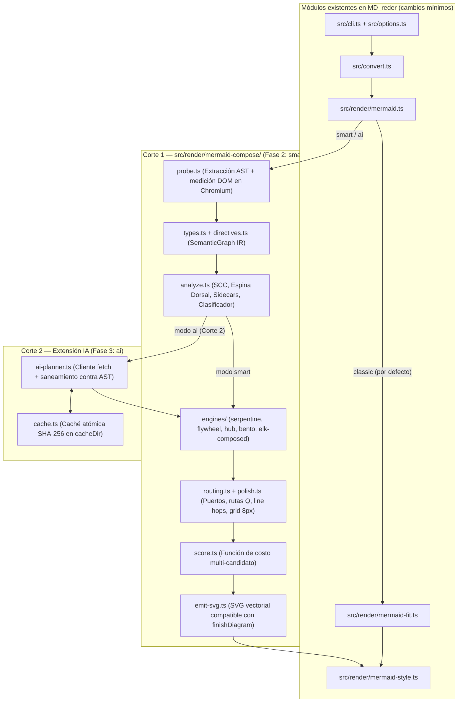
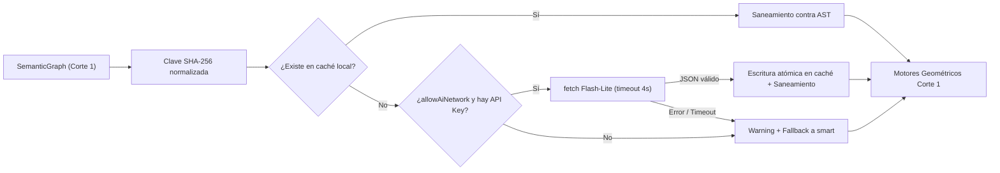

## 1. Objetivo, alcance y garantías de diseño

Agregar a `mdrender` (`@imontene/mdrender`) un nuevo subsistema de diagramación espacial para bloques ` ```mermaid ` que reinterpreta la topología y semántica del grafo antes de dibujar sus figuras y conectores, superando el layout lineal de Sugiyama sin sacrificar el acabado visual actual ni el modo de operación existente.

La implementación se realizará en **dos cortes independientes y publicables**:

- **Corte 1 (Fase 2 — modo `smart`):** Motor reintérprete 100 % determinista y sin conexión. Habilita `--mermaid-layout <classic|smart>`.
- **Corte 2 (Fase 3 — modo `ai`):** Pre-planificador semántico híbrido con modelo ligero y caché local persistente sobre los motores geométricos del Corte 1. Amplía la opción a `--mermaid-layout <classic|smart|ai>` y añade `--mermaid-ai-model`.

### 1.1 Modos de operación

| Modo (`--mermaid-layout`) |     Corte / Fase     | Descripción                                                                                                                                                                                                                                                                        | Por defecto | Red / Costo                  |
| :------------------------ | :------------------: | :--------------------------------------------------------------------------------------------------------------------------------------------------------------------------------------------------------------------------------------------------------------------------------- | :---------: | :--------------------------- |
| `classic`                 |     Base actual      | Pipeline vigente en `v2.18.0`: `mermaid.render()` + `mermaid-fit.ts` + `mermaid-style.ts`. Cero cambios de comportamiento.                                                                                                                                                         |   **Sí**    | Nunca / \$0                  |
| `smart`                   | **Corte 1 (Fase 2)** | Motor reintérprete determinista local: extracción a grafo intermedio, detección de espina dorsal y _sidecars_, motores especializados (**Serpentina**, **Flywheel**, **Hub bilateral**, **Bento de subgrafos** y **ELK con puertos cardinales fijos**) + acabado vectorial propio. |     No      | Nunca / \$0                  |
| `ai`                      | **Corte 2 (Fase 3)** | Pre-planificador semántico mediante un modelo de texto ultraligero (_Flash-Lite_) que emite roles y pistas de disposición en JSON (cacheado en disco por `SHA-256`), ejecutado geométricamente por los motores de Fase 2 con _fallback_ automático a `smart`.                      |     No      | Solo CLI + caché / ~\$0.0001 |

### 1.2 Invariantes no negociables de `mdrender`

1. **Retrocompatibilidad estricta:** Sin `--mermaid-layout` (o con `classic`), todas las salidas HTML/PDF y todas las pruebas actuales (`mermaid.test.ts`, `mermaid-autofit.test.ts`, `mermaid-style.test.ts`, `pdf.test.ts`) **deben** producir exactamente el mismo resultado que hoy.
2. **Cero banderas a medio implementar por corte:** En el **Corte 1**, `--mermaid-layout` solo acepta `classic` y `smart` (ni `ai` ni `--mermaid-ai-model` aparecen en `--help` ni en `VALIDATORS` hasta el **Corte 2**), de modo que el Corte 1 pueda publicarse limpio como versión _minor_ propia.
3. **PDF 100 % vectorial y tipografía incrustada:** Ningún diagrama generado por `smart` o `ai` puede introducir imágenes rasterizadas (`/Subtype /Image` = 0 en el PDF) ni sombras CSS que fuercen a Chromium a rasterizar capas. Todo texto de nodos, aristas y subgrafos se compone con la familia incrustada del documento (`Manrope` o `Inter`, y `JetBrains Mono` en `<code>`).
4. **Identidad visual unificada:** Los diagramas generados en `smart` y `ai` conservan el acabado de `mermaid-style.ts`: esquinas redondeadas (`CORNER_RADIUS = 5`), degradados verticales suaves por color (`GRADIENT_STEP = 4`) con opacidad `FILL_OPACITY = 0.72` dentro de los `<stop>` (para compatibilidad con marcas de agua `--watermark` / `--watermark-field` en Chrome PDF), cabeceras de subgrafo (`HEADER_STEP = 7`), variables de color de todos los temas (`antigravity`, `antigravity-dark`, `light`, `dark`, `academic_basic`, `tech_magazine`, `tech_magazine-dark`, `preprint`, `open_access`) y estilos `classDef` / `style` del autor.
5. **Frontera de seguridad de red (Corte 2):** Siguiendo la regla de `src/convert.ts` (_un documento no puede otorgarse acceso de red a sí mismo_), una clave `mermaid-layout: ai` escrita en el _front matter_ o en `mdrender.config.json` **solo consulta la caché local en disco**; las llamadas HTTP salientes al proveedor LLM **solo** se autorizan cuando `--mermaid-layout ai` se pasa explícitamente en la línea de comandos (o junto con `--allow-remote`), y se ejecutan desde Node (`fetch`), manteniendo `BrowserSession.newPage()` siempre con `restrictNetwork(page, false)`.
6. **Ejecutable independiente (Node SEA):** Todo código de ambos cortes debe empaquetarse limpiamente en `build/sea/mdrender(.exe)` mediante `scripts/build-sea.mjs` y registrar sus licencias en `THIRD-PARTY-NOTICES.txt`.

### 1.3 Tipos de diagramas cubiertos y delegación automática

| Tipo de diagrama Mermaid                                                         | Comportamiento en `smart` / `ai`                                                               | Razón                                                                                                         |
| :------------------------------------------------------------------------------- | :--------------------------------------------------------------------------------------------- | :------------------------------------------------------------------------------------------------------------ |
| `flowchart` / `graph` (`TB`, `TD`, `BT`, `LR`, `RL`)                             | **Reinterpretado** por los motores de Fases 2 y 3                                              | Constituyen el núcleo del problema de composición espacial (17 de los 20 casos de `mermaid-autofit.md`).      |
| `stateDiagram-v2` / `stateDiagram`                                               | **Reinterpretado** (normalizado al mismo Grafo Semántico IR; estados compuestos como clusters) | Es topológicamente un grafo dirigido de estados y ciclos donde `flywheel` y `serpentine` aportan gran mejora. |
| `sequenceDiagram`, `classDiagram`, `erDiagram`, `gantt`, `pie`, `mindmap`, otros | **Delegado transparentemente a `classic`**                                                     | Ya poseen gramáticas visuales posicionales estrictas (líneas de vida temporales, tartas, cronogramas).        |
| Diagramas con `%%{init: …}%%` o `config:` explícito del autor                    | **Delegado a `classic`** (salvo que incluya comentario `%% @archetype:` explícito)             | Respeta `authorConfigured()` tal como hoy lo hace `mermaid-fit.ts`.                                           |

---

## 2. Interfaz de línea de comandos, configuración y diagnósticos

### 2.1 Nuevas opciones por corte

Se registran en `src/cli.ts` (`DOCUMENT_FLAGS` y `addDocumentOptions`, disponibles tanto en `mdrender` como en `mdrender preview`), `src/options.ts` (`DocumentOptions`, `DEFAULT_OPTIONS`, `VALIDATORS`, `OPTION_KEYS`) y `mdrender.config.json`:

| Opción CLI                | Front matter / JSON                   | Valores en Corte 1 |         Valores en Corte 2          |        Por defecto        | Descripción                                                      |
| :------------------------ | :------------------------------------ | :----------------: | :---------------------------------: | :-----------------------: | :--------------------------------------------------------------- |
| `--mermaid-layout <mode>` | `mermaid-layout` / `mermaidLayout`    | `classic`, `smart` |      `classic`, `smart`, `ai`       |         `classic`         | Motor de composición espacial para diagramas de flujo y estados. |
| `--mermaid-ai-model <id>` | `mermaid-ai-model` / `mermaidAiModel` |  _(No expuesto)_   | texto (ej. `gemini-2.5-flash-lite`) | `"gemini-2.5-flash-lite"` | Modelo ligero empleado cuando `--mermaid-layout ai` está activo. |

**Credenciales y entorno para Corte 2 (`ai`) — solo variables de entorno, nunca en front matter ni `mdrender.config.json`:**

- `MDRENDER_AI_API_KEY` (prioritaria) o `GEMINI_API_KEY`.
- `MDRENDER_AI_BASE_URL` (opcional, para endpoints compatibles; respeta `HTTPS_PROXY` igual que `doctor.ts`).

> [!WARNING]
> **Seguridad de secretos:** `VALIDATORS` en `src/options.ts` **no debe** aceptar una opción `mermaidAiApiKey` en archivos de configuración ni en _front matter_, evitando que claves de API queden escritas accidentalmente en repositorios Markdown.

### 2.2 Compuerta exacta de red en `src/convert.ts` (Corte 2)

En `src/cli.ts`, `cliOverrides(program)` puebla `settings.overrides` únicamente cuando `program.getOptionValueSource(key) === "cli"`. En `src/convert.ts`, la autorización de red para el planificador de Fase 3 queda determinada sin ambigüedad por:

```ts
const allowAiNetwork = settings.overrides?.mermaidLayout === "ai" || Boolean(settings.allowRemote);
```

- Si `options.mermaidLayout === "ai"` y `allowAiNetwork === true`: consulta caché local $\rightarrow$ si no existe, consulta la API LLM y persiste en caché.
- Si `options.mermaidLayout === "ai"` y `allowAiNetwork === false` (proveniente de _front matter_ o `mdrender.config.json` sin flag en CLI): consulta caché local $\rightarrow$ si existe, la aplica; si no existe, emite un diagnóstico `warning` y renderiza con `smart`.

### 2.3 Precedencia e interacción con banderas existentes

1. **Prioridad general:** `CLI > front matter > mdrender.config.json > THEME_DEFAULTS > DEFAULT_OPTIONS`.
2. **Interacción con `--no-mermaid-autofit`:**
   - En `classic`: desactiva la búsqueda de `wrappingWidth` y eje, como hoy.
   - En `smart` / `ai`: ejecuta una única pasada del arquetipo seleccionado con ancho de etiqueta estándar (`190px`), sin búsqueda multi-candidato.
3. **Interacción con `--mermaid-flip never`:**
   - En `smart` / `ai`: prohíbe a los motores cambiar el eje global escrito por el autor (p. ej. no transponer un `bento` o `layered` de `LR` a `TB`, aunque sí permite plegar una cadena `LR` en serpentina horizontal `L→R / R→L`).
4. **Ajuste al marco de tarjeta en temas con relleno (`--diagram-frame`):**
   - En `tech_magazine` y `tech_magazine-dark` (donde `.mermaid-diagram` define `padding: 1.4em` y `--diagram-frame: 4.6em`), `renderDocument` descontará `2.8 * fontPx` del ancho útil y `4.6 * fontPx` de `pageHeightPx` al evaluar candidatos en `smart` / `ai`, coincidiendo con la caja impresa real que mide `FIGURE_FIT`.
5. **Salida detallada en `--verbose` (`describeLayout` ampliado en `src/convert.ts`):**
   - `classic`: sin cambios (`Mermaid autofit: wrap 300, turned LR→TB, scale 0.33 → 1.00…`).
   - `smart`: `Mermaid smart layout: archetype serpentine (4×2), sidecars [DB], scale 0.37 → 1.00, height 81 → 312 px (4 candidates tried)`.
   - `ai` (Corte 2): `Mermaid ai layout (cached|live): archetype bento, spine 5 nodes, sidecars [LOG, DB], scale 0.48 → 0.96, height 610 → 420 px`.
6. **Integración en `mdrender doctor` (`src/doctor.ts`):**
   - Corte 1: en el check `Settings`, añadir `, mermaid layout smart` cuando la configuración efectiva no sea `classic`.
   - Corte 2: si la configuración efectiva pide `ai`, añadir además un check `Mermaid AI` que informe la ruta de caché y si `MDRENDER_AI_API_KEY` / `GEMINI_API_KEY` está presente (`[ok]` o `[warn]` con sugerencia).

---

## 3. Arquitectura modular en el repositorio

### 3.1 Reutilización y puntos de contacto



### 3.2 Mapa de archivos por corte

| Archivo                                                           |      Corte      |    Tipo    | Responsabilidad                                                                                                                                                                          |
| :---------------------------------------------------------------- | :-------------: | :--------: | :--------------------------------------------------------------------------------------------------------------------------------------------------------------------------------------- |
| `src/options.ts`, `src/cli.ts`, `src/convert.ts`, `src/doctor.ts` | 1 (amplía en 2) | Modificado | Registro de `--mermaid-layout` (`classic\|smart` en Corte 1; `+ai` y `--mermaid-ai-model` en Corte 2), `allowAiNetwork`, trazas `--verbose` y `doctor`.                                  |
| `src/render/mermaid.ts`                                           | 1 (amplía en 2) | Modificado | Bifurcación por bloque: si `layoutMode === "classic"` o el diagrama no es reinterpretable, ejecuta el flujo actual intacto; si es `smart`/`ai`, invoca `composeDiagram()`.               |
| `src/render/mermaid-compose/types.ts`                             |        1        |   Nuevo    | Tipos puros del Grafo Semántico Intermedio (`SemanticGraph`, `AnalyzedGraph`, `PositionedGraph`).                                                                                        |
| `src/render/mermaid-compose/directives.ts`                        |        1        |   Nuevo    | Lector opcional de pistas en comentarios Mermaid (`%% @archetype:`, `%% @sidecar:`, `%% @spine:`).                                                                                       |
| `src/render/mermaid-compose/probe.ts`                             |        1        |   Nuevo    | Script evaluado en la página aislada de `renderMermaid` que extrae el grafo vía `mermaid.mermaidAPI.getDiagramFromText()`, resuelve colores efectivos y mide cajas de texto balanceadas. |
| `src/render/mermaid-compose/analyze.ts`                           |        1        |   Nuevo    | Algoritmos deterministas de grafos (Tarjan SCC, DFS _back-edges_, camino crítico, detección de _sidecars_, polaridad de decisiones y selección de arquetipo).                            |
| `src/render/mermaid-compose/engines/serpentine.ts`                |        1        |   Nuevo    | Motor de plegado en S (_boustrophedon_) con conectores en U y soporte de hojas laterales.                                                                                                |
| `src/render/mermaid-compose/engines/flywheel.ts`                  |        1        |   Nuevo    | Motor elíptico/poligonal horario para ciclos cerrados de 3 a 8 nodos (+ entrada/salida tangencial).                                                                                      |
| `src/render/mermaid-compose/engines/hub.ts`                       |        1        |   Nuevo    | Motor simétrico bilateral (alas Oeste/Este) y radial en 4 cuadrantes para topologías _Hub & Spoke_.                                                                                      |
| `src/render/mermaid-compose/engines/bento.ts`                     |        1        |   Nuevo    | Motor de contenedores `subgraph` con igualación de anchos por capa, igualación de altos por fila y retícula compartida.                                                                  |
| `src/render/mermaid-compose/engines/elk-composed.ts`              |        1        |   Nuevo    | Adaptador sobre `elkjs` (`elk.bundled.js` en Node) con puertos cardinales fijos (`FIXED_SIDE`) y zócalo desacoplado para nodos `sidecar`.                                                |
| `src/render/mermaid-compose/routing.ts`                           |        1        |   Nuevo    | Enrutador ortogonal con esquinas cuadráticas `Q`, puentes en cruces (_line hops_), arcos tangenciales y etiquetas anticolisión.                                                          |
| `src/render/mermaid-compose/polish.ts`                            |        1        |   Nuevo    | _Grid snapping_ (`8px`), igualación de dimensiones entre nodos hermanos y centrado óptico.                                                                                               |
| `src/render/mermaid-compose/score.ts`                             |        1        |   Nuevo    | Evaluación objetiva de candidatos (legibilidad `printScale`, ajuste de proporción, cruces y simetría).                                                                                   |
| `src/render/mermaid-compose/emit-svg.ts`                          |        1        |   Nuevo    | Serializador SVG vectorial compatible con `FIGURE_FIT`, `measureSvg` y `finishDiagram`.                                                                                                  |
| `src/render/mermaid-compose/cache.ts`                             |        2        |   Nuevo    | Caché atómica persistente en disco indexada por `SHA-256` bajo `cacheDir` de `mdrender`.                                                                                                 |
| `src/render/mermaid-compose/ai-planner.ts`                        |        2        |   Nuevo    | Cliente HTTP (`fetch` nativo de Node 22+), prompt JSON estructurado, saneamiento contra el AST y degradación limpia a `smart`.                                                           |

### 3.3 Dependencias y licencias

- **`elkjs` (`0.9.3`, licencia `EPL-2.0`):** Ya presente en `package-lock.json` como dependencia de `mermaid@12.1.0` e incluida en `THIRD-PARTY-NOTICES.txt`. En el Corte 1 se añade como dependencia directa en `package.json` (`"elkjs": "^0.9.3"`) importando `elkjs/lib/elk.bundled.js` (JS puro sin Web Workers, empaquetado directamente por `esbuild` dentro de `mdrender.cjs` en `scripts/build-sea.mjs` sin activos SEA adicionales).
- **Cero dependencias adicionales en el Corte 2:** Se usa `node:crypto`, `node:fs` y `globalThis.fetch` nativo de Node $\ge 22.12$.

---

## 4. Especificación del Corte 1: Fase 2 (`--mermaid-layout smart`)

### 4.1 Grafo Semántico Intermedio (`types.ts`)

Todo diagrama `flowchart`/`graph` o `stateDiagram-v2` se normaliza a la siguiente representación pura en Node antes de calcular posiciones:

```ts
export type NodeShape =
  | "rect" // [Texto]
  | "round" // (Texto)
  | "stadium" // ([Texto])
  | "cylinder" // [(Base de datos)]
  | "circle" // ((Texto)) / doble círculo
  | "diamond" // {¿Decisión?}
  | "hexagon" // {{Preparación}}
  | "parallelogram" // [/Entrada/] o [\Salida\]
  | "trapezoid" // [/Trapecio\] o [\Trapecio/]
  | "subroutine" // [[Subrutina]]
  | "asymmetric"; // >Bandera]

export type NodeRole =
  "entry" | "spine" | "branch" | "decision" | "hub" | "sidecar" | "error" | "sink";

export type EdgeKind = "primary" | "positive" | "negative" | "feedback" | "infra" | "normal";

export type Archetype = "serpentine" | "flywheel" | "hub" | "bento" | "layered";

export interface MeasuredSize {
  width: number;
  height: number;
  lines: string[];
}

export interface GraphNode {
  id: string;
  label: string;
  shape: NodeShape;
  clusterId?: string;
  order: number;
  style: {
    fill: string; // "rgb(...)" resuelto según tema + classDef + style
    stroke: string;
    textColor: string;
    strokeDasharray?: string;
  };
  /** Medidas reales en Chromium para cada ancho de envoltura candidato (140, 190, 250, 320 px). */
  sizes: Record<number, MeasuredSize>;
}

export interface GraphEdge {
  id: string;
  from: string;
  to: string;
  label?: string;
  labelSize?: { width: number; height: number };
  lineStyle: "solid" | "dotted" | "thick" | "invisible";
  arrowStart: boolean;
  arrowEnd: boolean;
  minLength: number; // Longitud de flecha en fuente: --> (1), ---> (2), ----> (3)
  order: number;
}

export interface GraphCluster {
  id: string;
  title: string;
  titleSize: { width: number; height: number };
  parentId?: string;
  direction?: "TB" | "BT" | "LR" | "RL";
  nodeIds: string[];
  childClusterIds: string[];
  style: { fill: string; stroke: string; textColor: string };
}

export interface SemanticGraph {
  diagramType: "flowchart" | "state";
  writtenDirection: "TB" | "BT" | "LR" | "RL";
  nodes: GraphNode[];
  edges: GraphEdge[];
  clusters: GraphCluster[];
  hints: LayoutHints; // Comentarios opcionales %% @...
}
```

#### Pistas opcionales en comentarios (`directives.ts`)

`directives.ts` reconoce comentarios opcionales compatibles al 100 % con cualquier visor Mermaid estándar:

- `%% @archetype: serpentine | flywheel | hub | bento | layered`
- `%% @sidecar: ID1, ID2`
- `%% @spine: A -> B -> C -> D`

Si están presentes, prevalecen sobre la heurística automática; en Mermaid crudo sin comentarios, `analyze.ts` deduce todo automáticamente.

### 4.2 Extracción AST y medición tipográfica balanceada (`probe.ts`)

Dentro de la página Chromium que `renderMermaid()` ya abre con las fuentes del documento cargadas:

1. **Extracción con adaptador defensivo:**
   - Ejecuta `mermaid.initialize(...)` con la configuración de tema activa y llama a `await mermaid.mermaidAPI.getDiagramFromText(source)`.
   - Si hay un error de sintaxis, devuelve el error estándar de Mermaid (conservando línea en el `.md`, resumen `Expecting ...`, bloque `.mermaid-error` y `ExitCode.Render = 2`).
   - Si `diag.type` es `flowchart-v2`, `flowchart`, `graph` o `stateDiagram-v2`, lee nodos, aristas, subgrafos y estilos desde `diag.db`. Si detecta primitivas exóticas sin geometría mapeada (p. ej. nodos de icono externo `@{ icon: ... }`) o cualquier discrepancia en `diag.db`, devuelve `{ kind: "fallback-classic" }` y `renderMermaid` dibuja ese diagrama con el flujo `classic` sin interrumpir el documento.
2. **Medición con envoltura tipográfica balanceada (_Balanced Line Wrapping_):**
   - Para cada etiqueta y ancho objetivo $W \in \{140, 190, 250, 320\}\text{ px}$:
     - Mide primero en una sola línea con la familia y peso exactos; si `naturalWidth <= W`, conserva 1 línea.
     - Si supera $W$, divide en $k = \lceil \text{naturalWidth} / W \rceil$ líneas minimizando la diferencia entre la línea más ancha y la más corta, evitando palabras sueltas al final y permitiendo corte limpio en identificadores de código largos (`encode_board(board: chess.Board)` del caso #16 de `mermaid-autofit.md`) tras `_`, `.`, `(`, `,`, `/` o espacio.
     - Añade las holguras geométricas propias de cada `NodeShape` (factor inscrito en `diamond`, puntas de `hexagon` / `asymmetric`, inclinación de `parallelogram` / `trapezoid` y tapa elíptica de `cylinder`).

### 4.3 Analizador topológico y semántico (`analyze.ts`)

Sobre `SemanticGraph` (ignorando aristas `invisible` para conectividad semántica pero preservándolas como orden relativo), ejecuta cinco pasos puros en `< 3 ms`:

1. **Descomposición en Ciclos y DAG Condensado:**
   - Algoritmo de **Tarjan** para componentes fuertemente conexas (SCC) + DFS desde las entradas ($\text{in-degree} = 0$, o el nodo de menor `order` si todo el grafo es cíclico) para etiquetar aristas de retorno como `feedback`.
2. **Detección de Nodos Transversales (`sidecar`):**
   - Calcula la profundidad topológica `depth(u)` sobre el DAG sin aristas `feedback`.
   - Un nodo $v$ fuera de subgrafos hoja se etiqueta como `sidecar` si cumple **ambas** condiciones:
     - Recibe aristas desde $\ge 3$ nodos situados en $\ge 2$ profundidades distintas ($\text{in-degree}(v) \ge 3$ y $|\{\text{depth}(u) : (u,v) \in E\}| \ge 2$).
     - Es un sumidero ($\text{out-degree}(v) = 0$), **o** solo alimenta a 1 nodo hoja de visualización/salida (como `LOG --> DASH` en el caso #15 de `mermaid-autofit.md`), **o** tiene `shape === "cylinder"`, **o** su etiqueta coincide (sin distinción de mayúsculas/acentos) con vocabulario de infraestructura transversal (`db`, `database`, `postgres`, `sql`, `redis`, `cache`, `buffer`, `log`, `logs`, `metricas`, `metrics`, `telemetria`, `audit`, `storage`, `s3`, `bus`, `queue`, `checkpoint`, `checkpoints`).
   - Además, nunca etiqueta como `sidecar` un vértice de articulación cuya eliminación desconecte las fuentes de los sumideros principales. Sus aristas entrantes se marcan como `infra`.
3. **Extracción de la Espina Dorsal (`spine`):**
   - Retirando temporalmente los nodos `sidecar` y las aristas `feedback`, calcula el **camino dirigido más largo ponderado** desde una fuente hasta un sumidero (desempatando por aristas no negativas y menor `order`). Sus nodos reciben `spine` (extremos `entry` y `sink`) y sus aristas `primary`.
4. **Polaridad de Decisiones y Excepciones:**
   - Nodos con `shape === "diamond"`, signos `¿...?` / `?...`, o $\text{out-degree} \ge 2$ con etiquetas de arista cortas ($\le 18$ caracteres) reciben rol `decision`.
   - Clasificación léxica multilingüe de sus salidas:
     - `positive`: `/^(s[ií]|yes|ok|true|v[aá]lido|éxito|pass|1|gana|promover)\b/i`
     - `negative`: `/^(no|error|fail|fallo|false|inv[aá]lido|reject|timeout|0|descartar)\b/i`
   - Hojas alcanzadas únicamente por aristas `negative` o punteadas (`dotted`, ej. `R -. desactivación .-> X` en `examples/articulo-academico.md`) reciben rol `error`.
5. **Árbol de Decisión de Arquetipo:**
   Sea $G_{\text{core}}$ el grafo sin nodos `sidecar` ($N = |V_{\text{core}}|$, $K = |\text{clusters raíz}|$):

   | Prioridad | Arquetipo elegido | Regla exacta de activación                                                                                                                                                                          |
   | :-------: | :---------------- | :-------------------------------------------------------------------------------------------------------------------------------------------------------------------------------------------------- |
   |     1     | _(Directiva)_     | Comentario `%% @archetype: <nombre>` presente en el bloque.                                                                                                                                         |
   |     2     | **`bento`**       | $K \ge 2$ subgrafos de nivel superior que agrupan al menos el $60\%$ de los nodos totales.                                                                                                          |
   |     3     | **`flywheel`**    | Una única SCC cíclica de $3 \le                                                                                                                                                                     | C   | \le 8$ nodos abarca $\ge 65\%$ de $V_{\text{core}}$ con grado medio interno $\le 2.4$ (admite hasta 1 `entry` previo y 1 `sink` posterior). |
   |     4     | **`serpentine`**  | $K = 0$, $N \ge 5$, espina dorsal $                                                                                                                                                                 | S   | \ge 0.75 N$, ramificación fuera de la espina $\le 1$ hoja lateral por nodo y sin ciclos largos ($> 2$ pasos).                               |
   |     5     | **`hub`**         | $K = 0$, $N \ge 5$, existe un nodo $h$ con grado total en $G_{\text{core}} \ge \max(4, \lceil 0.55 (N - 1) \rceil)$ cuya remoción divide $G_{\text{core}}$ en $\ge 4$ componentes de $\le 2$ nodos. |
   |     6     | **`layered`**     | Cualquier otro grafo (DAG general, árboles profundos, ciclos acoplados como MCTS/Gumbel).                                                                                                           |

### 4.4 Motores geométricos especializados (`engines/`)

Todos los motores son funciones puras en Node `(graph: AnalyzedGraph, wrapPx: number, options) => PositionedGraph`:

1. **`serpentine.ts` (Plegado en S / _Boustrophedon_):**
   - Evalúa columnas por fila $C \in \{2, 3, 4, 5\}$ ($C < |S|$).
   - Filas pares ($r = 0, 2, \dots$) fluyen Izquierda $\rightarrow$ Derecha; filas impares ($r = 1, 3, \dots$) fluyen Derecha $\rightarrow$ Izquierda.
   - Alinea centros verticales por columna y centros horizontales por fila; conecta el cambio de fila mediante un conector curvo exterior limpio de radio $\Delta y / 2$ sin cruzar cajas; aloja hojas laterales de 1 nodo (`branch` / `error`) en una sub-banda inmediata bajo su nodo padre conectada por el puerto Sur.
2. **`flywheel.ts` (Ciclo Elíptico / Poligonal):**
   - Sitúa los $k$ nodos del ciclo ($3 \le k \le 8$) en sentido horario comenzando a las 12 en punto ($\theta_0 = -\pi / 2$):
     $$\theta_i = -\frac{\pi}{2} + \frac{2\pi i}{k}, \qquad x_i = c_x + R_x \cos\theta_i, \qquad y_i = c_y + R_y \sin\theta_i$$
   - Calcula $(R_x, R_y)$ analíticamente garantizando separación mínima de `36px` entre cajas contiguas y proporción $R_x / R_y \in [1.0, 1.45]$.
   - Traza arcos cuadráticos tangenciales convexos entre nodos del anillo y entradas/salidas horizontales limpias para `entry`/`sink` externos.
3. **`hub.ts` (Simetría Bilateral / Radial):**
   - Coloca el `Hub` en el centro óptico `(cx, cy)` con ligero énfasis jerárquico (`padding +4px`, trazo `1.5px`).
   - Reparte las ramas en **Ala Oeste** y **Ala Este** equilibrando la altura total acumulada de ambos lados (entradas al Oeste y salidas al Este cuando coexisten; mitad y mitad cuando todas tienen la misma dirección, como las 6 aperturas del caso #9 de `mermaid-autofit.md`), reduciendo a la mitad la altura vertical y conectando mediante buses ortogonales distribuidos sobre los puertos Oeste y Este del `Hub`.
4. **`bento.ts` (Grilla Arquitectónica de Subgrafos):**
   - Calcula primero el layout interno de cada `subgraph`, luego posiciona los contenedores raíz y aplica **normalización _Bento_**:
     - Subgrafos apilados en una misma columna igualan exactamente su ancho exterior a $W_{\text{bento}} = \max_j W_j$, redistribuyendo simétricamente el espacio interno sobre una retícula común.
     - Subgrafos en paralelo en una misma fila igualan su altura exterior a $H_{\text{bento}} = \max_j H_j$.
     - Reserva exactamente `SUBGRAPH_TITLE_MARGIN` en la cabecera de cada `subgraph` para la franja de `addClusterHeads()`.
5. **`elk-composed.ts` (DAG General con Puertos Cardinales Fijos y Zócalo Sidecar):**
   - Extrae los nodos `sidecar` antes de invocar `elk.layout()` sobre `elkjs/lib/elk.bundled.js` para impedir que colapsen los rangos del flujo primario, y los ubica después en un **zócalo inferior** (flujo `LR`) o **carril derecho** (flujo `TB`) alineados con el baricentro de sus emisores.
   - Asigna puertos cardinales explícitos (`elk.portConstraints: "FIXED_SIDE"`):
     - En `TB`: flujo `primary`/`positive`/`normal` usa `NORTH` $\rightarrow$ `SOUTH`; ramas `negative` salen por `EAST`/`WEST`; aristas `feedback` (_back-edges_) salen por `EAST`, suben por un canal lateral despejado y re-entran por `EAST` del nodo ancestro; aristas `infra` bajan agrupadas (`mergeEdges: true`) al carril `sidecar`.
     - En `LR`: transposición simétrica (`WEST` $\rightarrow$ `EAST` primario; `SOUTH` para ramas negativas, _feedback_ y zócalo `sidecar`).

### 4.5 Enrutamiento (`routing.ts`), Pulido (`polish.ts`) y Evaluación (`score.ts`)

- **Esquinas y cruces (`routing.ts`):** Giros ortogonales suavizados con curvas cuadráticas `Q` de radio `min(8, segLen / 3)`; puentes semicirculares de `4px` (_line hops_) en cruces ortogonales inevitables; pastillas de etiqueta de arista desplazadas automáticamente a lo largo del tramo recto si colisionan con cualquier nodo u otra etiqueta.
- **Retícula y hermandad (`polish.ts`):** _Snap_ de centros alineados a múltiplos de `8px` e igualación de `width` entre nodos hermanos de la misma forma en una misma capa/fila cuya diferencia de ancho sea $< 35\%$.
- **Selección multi-candidato (`score.ts`):** Con `autofit: true`, evalúa de 3 a 5 candidatos (arquetipo principal en anchos `190px` y `250px` —más `320px` para etiquetas largas—, eje transpuesto si `flip === "auto"` en arquetipos direccionales, y el candidato `classic` base como piso de seguridad) maximizando:

$$
U(c) = 100 \cdot S(c) - 12 \cdot \left| \ln\left(\frac{W_c / H_c}{R_{\text{objetivo}}}\right) \right| - 4 \cdot \text{Cruces}(c) - 6 \cdot \text{Desbalance}(c)
$$

con la restricción dura $S(c) \ge S(\text{base}) - 0.05$, garantizando que ningún diagrama se imprima con letra menos legible que su versión original.

### 4.6 Contrato exacto de emisión SVG (`emit-svg.ts`)

Para integrarse sin fisuras con `theme.css`, `FIGURE_FIT` (`src/render/browser.ts`), `measureSvg()` (`src/render/mermaid-fit.ts`) y `finishDiagram()` (`src/render/mermaid-style.ts`), el SVG emitido **debe** cumplir:

1. **Elemento raíz `<svg>`:**
   ```html
   <svg
     id="mermaid-N"
     xmlns="http://www.w3.org/2000/svg"
     viewBox="0 0 W H"
     width="100%"
     style="max-width: Wpx;"
     role="graphics-document document"
     aria-roledescription="flowchart-v2"
   ></svg>
   ```
   _(Sin atributo fijo `height="..."`, para que `height: auto` y `max-height: calc(...)` en `@media print` mantengan la proporción exacta cuando `FIGURE_FIT` reserva `--caption-room`)._
2. **Estructura de `subgraph` compatible con `addClusterHeads()` (`mermaid-style.ts` línea 306):**
   Emitir exactamente la secuencia `<g class="cluster" id="..."><rect x="..." y="..." width="..." height="..." rx="5" ry="5" style="stroke: ...; stroke-width: 1px" data-mdr-cluster-fill="rgb(...)"></rect><g class="cluster-label" transform="translate(tx, ty)"><foreignObject width="lw" height="lh"><div>...</div></foreignObject></g></g>`.
3. **Estructura de nodos compatible con `addFillGradients()` y `roundNodePolygons()`:**
   Emitir `data-mdr-fill="rgb(...)"` en cada figura de nodo (`.label-container`, `circle`, `ellipse`, `.outer-path path`), reutilizar `roundedPolygonPath()` para diamantes, hexágonos, paralelogramos, trapecios y banderas, e invocar al final `finishDiagram(svg)` para inyectar los `<linearGradient>` con `stop-opacity="0.72"` y las bandas `path.cluster-head`.

---

## 5. Especificación del Corte 2: Fase 3 (`--mermaid-layout ai`)

El Corte 2 incorpora sobre la tubería ya probada del Corte 1 un planificador semántico ligero cacheado por contenido, pensado para grafos complejos donde el rol conceptual de cada bloque mejora la composición más allá de la topología pura.

### 5.1 Flujo de ejecución y compuerta de red (`ai-planner.ts`)



1. **Clave de caché inmune a formato:**
   `key = sha256(JSON.stringify({ v: 1, model, nodes: id+label+shape, edges: from+to+label, clusters: id+title }))`.
2. **Privacidad:** El cuerpo de la petición HTTP incluye exclusivamente ese resumen estructural del grafo y la razón de aspecto disponible (`widthPx / pageHeightPx`), nunca el resto del documento `.md`.
3. **Timeout y resiliencia:** `AbortSignal.timeout(4000)`. Ante cualquier fallo de red, cuota, HTTP $\neq 200$ o JSON inválido, registra un `Diagnostic` con `severity: "warning"` (no aborta la conversión ni devuelve código `2`) y delega de inmediato al analizador `smart` del Corte 1.

### 5.2 Esquema JSON (`AiLayoutPlan`) y saneamiento frente al AST

```ts
export interface AiLayoutPlan {
  archetype: "serpentine" | "flywheel" | "hub" | "bento" | "layered";
  preferredAxis?: "TB" | "LR";
  spine?: string[];
  roles?: Record<string, "entry" | "spine" | "decision" | "hub" | "sidecar" | "error" | "sink">;
  wings?: Record<string, "west" | "east">;
  edgeKinds?: Record<string, "primary" | "positive" | "negative" | "feedback" | "infra">;
}
```

Reglas de saneamiento estricto antes de pasar a los motores del Corte 1:

- Se descartan IDs inexistentes en `SemanticGraph`.
- Si `archetype === "flywheel"` pero el grafo carece de ciclos, o `archetype === "hub"` sin ningún nodo de grado $\ge 3$, se conserva el arquetipo calculado por `analyze.ts`.
- Si `roles[id] === "sidecar"` desconecta todas las rutas entre fuentes y sumideros principales, esa asignación se ignora.
- El LLM jamás emite coordenadas en píxeles: toda posición, tamaño de caja y ruta vectorial la calculan los motores deterministas del Corte 1.

### 5.3 Caché persistente (`cache.ts`)

- **Ubicación:** `<cacheDir>/mermaid-layout/v1/<primeros-2-hex>/<sha256>.json`, reutilizando `cacheDir(env, platform)` de `src/browser/cache.ts` (`%LOCALAPPDATA%\mdrender` en Windows, `~/.cache/mdrender` en Linux).
- **Escritura atómica:** Archivo temporal en la misma subcarpeta + `renameSync`, seguro frente a procesos concurrentes, lotes, `--watch` y `mdrender preview`.

---

## 6. Pruebas y criterios de aceptación por corte

### 6.1 Pruebas del Corte 1 (Fase 2: `smart`)

| Archivo de prueba                                                    | Qué verifica                                                                                                                                                                                                                                                                                                                           | Navegador |
| :------------------------------------------------------------------- | :------------------------------------------------------------------------------------------------------------------------------------------------------------------------------------------------------------------------------------------------------------------------------------------------------------------------------------- | :-------: |
| `tests/options.test.ts`, `tests/cli.test.ts`, `tests/doctor.test.ts` | Validación de `--mermaid-layout <classic\|smart>`, prioridad de capas, rechazo de valores desconocidos con `ExitCode.Usage`, sugerencia de typos y reporte en `doctor`.                                                                                                                                                                |    No     |
| `tests/mermaid-analyze.test.ts` _(nuevo)_                            | Ciclos (Tarjan), espina dorsal, detección de `sidecar` (incluyendo exclusión de vértices de articulación), polaridad `Sí`/`No` y selección de los 5 arquetipos + directivas `%% @archetype:`.                                                                                                                                          |    No     |
| `tests/mermaid-engines.test.ts` _(nuevo)_                            | Cero solapamiento de cajas y etiquetas en `serpentine`, `flywheel`, `hub`, `bento` y `elk-composed`; igualación exacta de anchos en `bento`; simetría bilateral en `hub`; _snap_ a `8px`.                                                                                                                                              |    No     |
| `tests/mermaid-smart.test.ts` _(nuevo)_                              | Conversión real a HTML y PDF con `--mermaid-layout smart` en `antigravity`, `antigravity-dark`, `academic_basic` y `tech_magazine`: extracción de texto con `pdfjs-dist`, `/Subtype /Image` = `0`, degradados y `cluster-head` presentes, respeto de `--caption-room` y delegación intacta a `classic` para `sequenceDiagram` y `pie`. |    Sí     |

**Criterios de aceptación para cerrar y publicar el Corte 1:**

1. Sin `--mermaid-layout` (modo `classic`), `npm run check` pasa íntegro sin alterar ninguna aserción existente y con cobertura global $\ge 80\%$.
2. Con `--mermaid-layout smart`, sobre `tests/fixtures/mermaid-autofit.md` + nuevo fixture `tests/fixtures/mermaid-smart.md`:
   - Cadenas lineales de $\ge 6$ pasos se pliegan en serpentina con escala $\ge 0.90$ y reducción de altura $\ge 35\%$ frente a una torre `TB`.
   - Subgrafos apilados en `bento` tienen exactamente el mismo `width` en el SVG generado.
   - Nodos `sidecar` (`DB`, `LOG`) se ubican en su zócalo sin atravesar nodos del flujo primario.
   - Ningún diagrama pierde escala legible frente a su versión escrita ni introduce imágenes bitmap en el PDF.
3. `npm run build:exe` empaqueta `mdrender(.exe)` con `elkjs` incluido, actualiza `THIRD-PARTY-NOTICES.txt` y convierte correctamente un `.md` con `--mermaid-layout smart` fuera del repositorio.

### 6.2 Pruebas del Corte 2 (Fase 3: `ai`)

| Archivo de prueba                                                    | Qué verifica                                                                                                                                                                                                                                                                                                                     | Navegador |
| :------------------------------------------------------------------- | :------------------------------------------------------------------------------------------------------------------------------------------------------------------------------------------------------------------------------------------------------------------------------------------------------------------------------- | :-------: |
| `tests/options.test.ts`, `tests/cli.test.ts`, `tests/doctor.test.ts` | Ampliación de `MERMAID_LAYOUTS` con `ai`, opción `--mermaid-ai-model`, prohibición de API keys en config/front matter y check `Mermaid AI` en `doctor`.                                                                                                                                                                          |    No     |
| `tests/mermaid-ai.test.ts` _(nuevo)_                                 | Mock de `fetch`: escritura y lectura atómica en caché `SHA-256`, verificación estricta de `allowAiNetwork` (front matter `mermaid-layout: ai` sin flag CLI **no** invoca `fetch`, usa caché si existe y emite `warning` + `smart` si no existe), saneamiento de IDs alucinados y _fallback_ a `smart` ante timeout o error HTTP. |    No     |

**Criterios de aceptación para cerrar y publicar el Corte 2:**

1. Todas las pruebas del Corte 1 y `mermaid-ai.test.ts` pasan en `npm run check` con cobertura $\ge 80\%$.
2. Segunda conversión consecutiva de un mismo diagrama con `--mermaid-layout ai` realiza `0` peticiones HTTP y reporta `Mermaid ai layout (cached)` en `--verbose`.
3. Un archivo `.md` con `mermaid-layout: ai` en su _front matter_ ejecutado sin `--mermaid-layout ai` ni `--allow-remote` en CLI realiza `0` peticiones de red (auditado por mock de `fetch`).
4. `npm run build:exe` compila y supera las pruebas del ejecutable independiente.

---

## 7. Plan de ejecución en dos cortes

### Corte 1 — Entrega de Fase 2 (`--mermaid-layout <classic|smart>`)

|  Paso   | Contenido                                                                                                                                                                                                                                  | Tamaño | Depende de |
| :-----: | :----------------------------------------------------------------------------------------------------------------------------------------------------------------------------------------------------------------------------------------- | :----: | :--------: |
| **1.1** | Dependencia directa `elkjs` en `package.json`; opción `--mermaid-layout <classic\|smart>` en `options.ts`, `cli.ts`, `convert.ts` y `doctor.ts`; pruebas de opciones y CLI.                                                                |   S    |     —      |
| **1.2** | `types.ts`, `directives.ts`, `probe.ts` (extracción desde `mermaidAPI` en Chromium + envoltura tipográfica balanceada) y `emit-svg.ts` integrado con `mermaid-style.ts` y `FIGURE_FIT`.                                                    |   M    |    1.1     |
| **1.3** | `analyze.ts` (Tarjan SCC, espina dorsal, detector de `sidecar`, polaridad de decisiones y selector de arquetipo) + `tests/mermaid-analyze.test.ts`.                                                                                        |   M    |    1.2     |
| **1.4** | Motores no jerárquicos (`serpentine.ts`, `flywheel.ts`, `hub.ts`, `bento.ts`) + `polish.ts` (_grid snap_ e igualación de hermanos) + pruebas geométricas.                                                                                  |   L    |    1.3     |
| **1.5** | Motor `elk-composed.ts` (puertos cardinales fijos + zócalo `sidecar`), `routing.ts` (curvas `Q`, _line hops_, etiquetas anticolisión) y `score.ts` (búsqueda multi-candidato).                                                             |   L    |  1.3, 1.4  |
| **1.6** | Corpus `tests/fixtures/mermaid-smart.md`, integración `tests/mermaid-smart.test.ts`, ampliación de `bench:mermaid`, documentación del Corte 1 (`README.md`, `CHANGELOG.md`) y validación completa (`npm run check` + `npm run build:exe`). |   M    |  1.4, 1.5  |

### Corte 2 — Entrega de Fase 3 (`--mermaid-layout <classic|smart|ai>`)

|  Paso   | Contenido                                                                                                                                                                                | Tamaño | Depende de |
| :-----: | :--------------------------------------------------------------------------------------------------------------------------------------------------------------------------------------- | :----: | :--------: |
| **2.1** | Ampliar `--mermaid-layout` con `ai`, añadir `--mermaid-ai-model`, compuerta `allowAiNetwork` en `convert.ts`, check `Mermaid AI` en `doctor.ts` y módulo `cache.ts` (`SHA-256` atómico). |   S    |  Corte 1   |
| **2.2** | Implementar `ai-planner.ts` (cliente `fetch` con timeout de 4 s, prompt estructurado, validador/reconciliador contra AST y degradación limpia a `smart`) + `tests/mermaid-ai.test.ts`.   |   M    |    2.1     |
| **2.3** | Documentación del Corte 2 en `README.md`, `docs/ESPECIFICACION_TEMAS.md` y `CHANGELOG.md`; validación integral (`npm run check` + `npm run build:exe`).                                  |   S    |    2.2     |

---

## 8. Riesgos y mitigaciones

| Riesgo                                                                                              | Impacto | Mitigación prevista en diseño                                                                                                                                                                                                                         |
| :-------------------------------------------------------------------------------------------------- | :-----: | :---------------------------------------------------------------------------------------------------------------------------------------------------------------------------------------------------------------------------------------------------- |
| Cambio futuro en métodos internos de `diag.db` al actualizar `mermaid` a una versión mayor (`v13+`) |  Medio  | Aislar toda lectura de `diag.db` en un único archivo (`probe.ts` < 150 líneas) cubierto por pruebas de contrato; ante cualquier estructura inesperada, devolver `fallback-classic` para que el diagrama se siga dibujando sin romper la conversión.   |
| Etiquetas con código o palabras larguísimas sin espacios desbordan la caja calculada                |  Medio  | La medición ocurre en el mismo Chromium y con las mismas fuentes incrustadas (`Manrope`/`Inter`/`JetBrains Mono`) que imprimen el PDF, aplicando partición por delimitadores de código y `overflow-wrap: anywhere` de seguridad en `<foreignObject>`. |
| Desajuste de escala en temas con tarjeta (`tech_magazine`) o epígrafe (`figcaption`)                |  Medio  | Emitir `<svg viewBox="0 0 W H" width="100%" style="max-width: Wpx;">` sin `height` fijo (respetando `FIGURE_FIT` y `@media print`) y descontar `--diagram-frame` al puntuar candidatos.                                                               |
| Un arquetipo especializado (`serpentine` o `hub`) rinde peor que `classic` en un grafo atípico      |  Bajo   | `score.ts` evalúa también la base `classic` y descarta cualquier candidato cuya escala impresa caiga por debajo del umbral de tolerancia ($S(\text{base}) - 0.05$).                                                                                   |
| Latencia, falta de red o JSON malformado en `--mermaid-layout ai` (Corte 2)                         |  Bajo   | Caché persistente por `SHA-256` (1 sola llamada en la vida del diagrama), `AbortSignal.timeout(4000)`, validación estricta contra IDs reales del AST y degradación automática con `warning` a `smart`.                                                |

---

## 9. Decisiones confirmadas (27 de noviembre de 2026)

1. **Parámetro y valores:** Se adopta `--mermaid-layout <classic|smart|ai>` (junto con `mermaid-layout` / `mermaidLayout` en _front matter_ y `mdrender.config.json`), manteniendo `classic` como valor por defecto para conservar intacto el renderizado actual, `smart` para la Fase 2 determinista offline y `ai` para la Fase 3 híbrida cacheada.
2. **Frontera de red en Fase 3 (`ai`):** Siguiendo el modelo de seguridad de `--allow-remote` en `MD_reder`, `mermaid-layout: ai` en _front matter_ o `mdrender.config.json` solo consume planes ya existentes en la caché local; las llamadas de red al proveedor de IA requieren autorización explícita en la línea de comandos (`--mermaid-layout ai` o `--allow-remote`) y, en ausencia de red, clave o acierto en caché, degradan con advertencia al motor `smart`.
3. **Estrategia de entrega en dos cortes:** Se implementará y validará primero el **Corte 1 completo (`--mermaid-layout <classic|smart>`, pasos 1.1 a 1.6)** como entrega autónoma lista para uso y publicación, y a continuación se abordará el **Corte 2 (`ai`, pasos 2.1 a 2.3)** sobre esa base.
