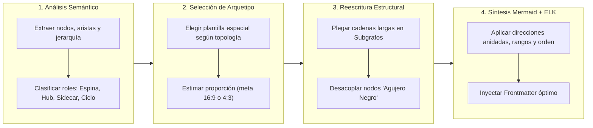
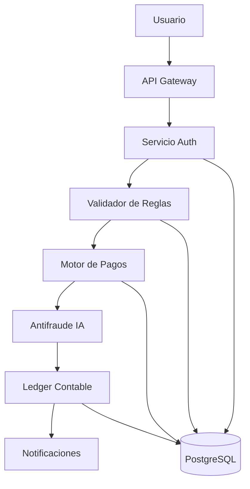
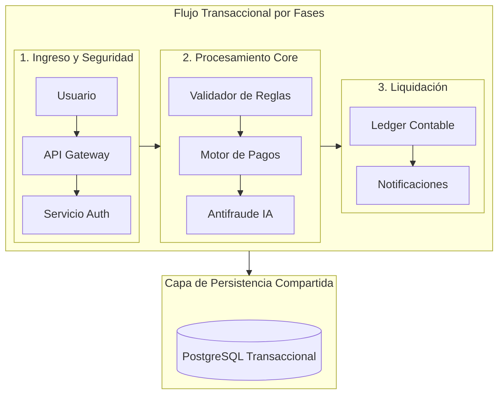
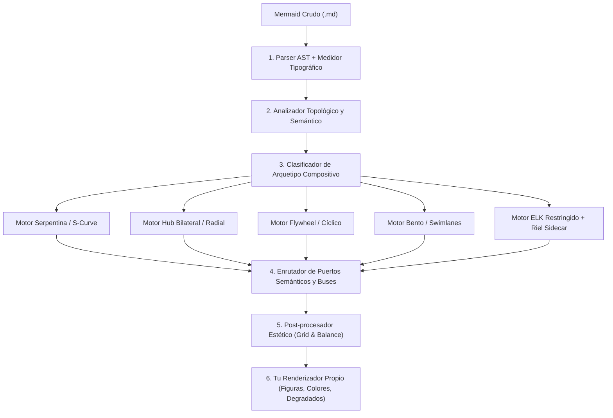

# Ideación Arquitectónica: Diagramación Inteligente de Mermaid más allá del Layout Lineal

## 1. Diagnóstico Raíz: ¿Qué hace una IA gráfica de frontera que Mermaid no hace?

Cuando ya tienes resuelto el **acabado superficial** (tipografía, sombras, radios, paletas, degradados y estilo de trazos), la diferencia percibida frente a un modelo visual de frontera como _Nano Banana_ deja de ser cosmética y pasa a ser puramente **compositiva y topológica**.

Los motores clásicos detrás de Mermaid (`dagre` históricamente y `elk.layered` en versiones modernas) implementan variantes del **algoritmo jerárquico de Sugiyama (1981)**: eliminan ciclos invirtiendo flechas, asignan cada nodo a una capa discreta (_rank_), minimizan cruces y calculan coordenadas en **un único eje global** (`TD` o `LR`). En cambio, una IA visual de frontera comprende la semántica del sistema y toma cinco decisiones de diseño editorial que Sugiyama ignora:

1. **Control del _Aspect Ratio_ y Plegado del Flujo (Adiós al "Efecto Cinta"):** Si un proceso tiene 9 pasos secuenciales, Mermaid genera una torre vertical altísima o una tira horizontal ilegible. Un diseñador humano o una IA visual pliega la secuencia en **serpentina (curva en S / _boustrophedon_)** o en una **retícula de fases (3×3)** para encajar armónicamente en una proporción 16:9 o 4:3.
2. **Reconocimiento del Arquetipo Visual:** Mermaid usa el mismo motor jerárquico para todo. Una IA visual detecta la naturaleza cognitiva del grafo antes de dibujar:
   - Un **ciclo continuo** (_flywheel_ / bucle RL) lo dispone en círculo o cuadrado cerrado, no como una escalera vertical con una flecha larga regresando desde el fondo hasta arriba.
   - Un **orquestador central con herramientas** (_Hub & Spoke_) lo centra con ramas equilibradas a izquierda y derecha, no como un embudo asimétrico de 1 nodo arriba y 7 cajas apelmazadas abajo.
   - Una **arquitectura por capas** la alinea en bandas horizontales de **mismo ancho exterior** (estilo _Bento Box_), en lugar de encoger cada `subgraph` al ancho accidental de sus hijos.
3. **Separación entre "Espina Dorsal" y "Nodos Transversales" (_Sidecars_):** En un diagrama real suele haber nodos de infraestructura compartida (`Base de Datos`, `Logger`, `Event Bus`, `Auth`) conectados a 4 o 5 etapas del flujo principal. En Mermaid, ese nodo actúa como un **agujero negro gravitacional**: arrastra todos los rangos hacia sí, cruza líneas por encima del flujo primario y destruye la jerarquía visual. Una IA frontera dibuja el flujo principal limpio y coloca los recursos transversales en un **riel lateral o zócalo inferior** con conexiones ortogonales discretas.
4. **Uso Semántico de Puertos Cardinales (Norte, Sur, Este, Oeste):** Mermaid tiende a concentrar entradas por una cara y salidas por la opuesta. En una buena diagramación, el **flujo feliz (_happy path_)** entra por Norte y sale por Sur (o Oeste $\rightarrow$ Este), mientras que **errores, reintentos, excepciones y metadatos** salen perpendicularmente por los puertos laterales (Este/Oeste).
5. **Equilibrio de Masa Visual y Retícula (_Grid Snapping_):** Igualación de tamaños entre nodos hermanos, envoltura intencional del texto para evitar cajas ultra-anchas junto a cajas minúsculas, y agrupación de flechas paralelas en **buses compartidos** (_edge bundling_).

> [!IMPORTANT]
> **Tesis central de esta ideación:** No necesitas pagar el costo computacional ni perder el determinismo/editabilidad vectorial de una IA generativa de píxeles para capturar el 80–90% de esa mejora. La clave está en separar **estructura semántica** de **geometría de disposición**, ya sea al generar el código fuente (Enfoque 1), al reinterpretarlo antes de pintar tus componentes gráficos (Enfoque 2), o combinando ambos.

---

## 2. Enfoque 1: Skill de "Planificación Espacial Previa" al Generar el Mermaid Fuente

Este enfoque actúa **aguas arriba (_upstream_)**: dado que una IA de texto ya genera el código Mermaid, creamos un **Skill especializado** que prohíbe al LLM escribir sintaxis linealmente a medida que piensa y lo obliga a ejecutar primero una fase de **arquitectura espacial**, traduciendo esa intención a las palancas estructurales que el DSL de Mermaid sí permite controlar.

### 2.1 Flujo Cognitivo del Skill (4 Pasos antes de emitir código)



### 2.2 Catálogo de Decisiones y "Trucos de Maestría" que el Skill debe codificar

#### A. Selección explícita de Arquetipo y Plegado mediante Subgrafos Ortogonales

La herramienta más potente y menos utilizada en Mermaid es **combinar una dirección macro en el diagrama raíz con la dirección opuesta dentro de `subgraph`**. El Skill debe aplicar reglas deterministas según la topología detectada:

| Topología detectada por el LLM                         | Problema en Mermaid ingenuo                               | Transformación que aplica el Skill                                                                                                                          |
| :----------------------------------------------------- | :-------------------------------------------------------- | :---------------------------------------------------------------------------------------------------------------------------------------------------------- |
| **Secuencia lineal larga** ($> 5$ pasos)               | Tira horizontal minúscula o torre vertical interminable   | Agrupar cada 2–4 pasos conexos en `subgraph` de fases: raíz `flowchart LR` con subgrafos internos `direction TB` (crea columnas de lectura tipo _tablero_). |
| **Hub & Spoke** (1 nodo central con $\ge 4$ satélites) | Muro plano de $N$ nodos en un solo nivel                  | Dividir satélites en dos grupos semánticos equilibrados: `Grupo_Izq --> Hub --> Grupo_Der` en `flowchart LR` (logra simetría bilateral).                    |
| **Ciclo cerrado** (3 a 6 etapas con retorno al inicio) | Torre vertical con una flecha larga lateral cruzando todo | Organizar en 2 subgrafos paralelos (`Ida` e `Inverso/Feedback`) o forzar rangos simétricos para formar un rectángulo de 2 columnas.                         |
| **Arquitectura por capas** (UI, API, Dominio, Datos)   | Cajas desordenadas sin fronteras claras                   | `flowchart TB` en raíz con un `subgraph` por capa y `direction LR` dentro de cada capa + eslabones invisibles `~~~` entre capas si falta conexión directa.  |
| ** Árbol con manejo de errores**                       | Las ramas de error desvían y tuercen el camino principal  | Declarar primero toda la **espina dorsal** (_happy path_) y agrupar salidas de fallo en un `subgraph` lateral de contingencia.                              |

#### B. Neutralización de Nodos "Agujero Negro" (_Cross-cutting Concerns_)

El Skill debe incluir una regla estricta: **ningún nodo de infraestructura transversal (`DB`, `Cache`, ` Telemetría`, `Auth`, ` Cola`) puede recibir más de 3 flechas desde rangos distintos del flujo principal**. Cuando detecte ese patrón, el Skill elige una de tres tácticas:

1. **Conexión a nivel de contenedor:** Agrupar los servicios consumidores en un `subgraph Backend` y trazar **una sola arista** desde el subgrafo hacia la base de datos (`Backend --> DB`), en lugar de 5 flechas individuales.
2. **Empuje de rango (_Rank Spanning_):** Usar flechas de longitud extendida (`--->` o `---->`) hacia los nodos de persistencia/salida final para forzarlos al zócalo inferior sin comprimir las capas intermedias.
3. **Nodos insignia (_Badge duplication_):** Si `Auth` o `Logs` es puramente transversal y secundario, representarlo como anotación de etapa o sub-nodo local en lugar de cruzar el lienzo entero.

#### C. Palancas Sintácticas de Precisión en Mermaid

El Skill debe dominar cinco mecanismos nativos de Mermaid que los LLMs casi nunca usan por defecto:

- **Inyección dinámica de `ELK` en el _Frontmatter_:** En diagramas con ramificaciones complejas o múltiples aristas, el Skill antepone configuración específica de ELK, activando `mergeEdges: true` (que agrupa flechas en carriles compartidos estilo circuito impreso) y estrategias de colocación equilibradas:
  ```yaml
  ---
  config:
    layout: elk
    elk:
      mergeEdges: true
      nodePlacementStrategy: BRANDES_KOEPF
      cycleBreakingStrategy: GREEDY
  ---
  ```
- **Andamiaje invisible (`~~~`):** Para alinear en grilla dos columnas o subgrafos desconectados, o forzar que la leyenda/infraestructura quede debajo del flujo principal (`Subgrafo_Principal ~~~ Subgrafo_Infraestructura`).
- **Ingeniería del orden de declaración:** Tanto `dagre` como `elk` utilizan el orden de aparición en el texto como desempate inicial para ordenar nodos dentro de una misma capa. El Skill debe emitir: (1) definiciones de nodos con etiquetas balanceadas, (2) subgrafos en orden estricto de lectura (izquierda a derecha / arriba a abajo), (3) aristas de la espina dorsal, y (4) aristas secundarias o de retorno al final.
- **Control tipográfico de proporción de cajas:** Limitar cada línea de texto de un nodo a **18–26 caracteres** (partiendo conceptos largos en 2 líneas concisas) para evitar nodos de 400px de ancho que deforman toda su columna.

### 2.3 Ejemplo Comparativo del Efecto del Skill

````carousel

<!-- slide -->

````

> [!TIP]
> **Estructura interna recomendada para el `SKILL.md`:** En lugar de pedirle al LLM un _Chain-of-Thought_ libre y verboso (que gasta tokens de salida), pídele que rellene primero un brevísimo bloque de planificación estructurada en comentario Mermaid (`%% @plan: nodes=8 | archetype=phased-grid | aspect=16:9 | god_nodes=DB(isolated)`). Así fuerzas el razonamiento espacial en ~25 tokens y el archivo resultante sigue siendo 100% Mermaid válido.

### 2.4 Alcance y Límites Reales del Enfoque 1

- **Lo que resuelve muy bien:** Elimina torres infinitas, ordena arquitecturas en fases comprensibles, reduce drásticamente cruces de cables por bases de datos/logs compartidos y aprovecha `ELK` sin tocar una línea de tu renderizador. **Costo adicional: prácticamente \$0** (sólo unos pocos tokens extra de prompt/salida en la generación que ya haces).
- **Dónde choca contra el muro de Mermaid:**
  1. **No hay serpentina verdadera (_U-turn_):** En Mermaid no puedes hacer que la fila 1 fluya de izquierda a derecha y la fila 2 fluya de derecha a izquierda manteniendo orden y flechas naturales sin que el motor invierta los rangos.
  2. **No hay geometría radial ni circular real:** Un _flywheel_ o un _hub-and-spoke_ seguirá siendo ortogonal/jerárquico, nunca circular o concéntrico.
  3. **No hay igualación de anchos (_Bento sizing_):** Dos capas apiladas tendrán anchos distintos si una tiene 2 nodos y otra tiene 4, rompiendo la estética de bloque arquitectónico limpio.
  4. **No sirve para Mermaid heredado o externo** que no haya sido creado con tu Skill.

---

## 3. Enfoque 2: Reinterpretación Semántica y Espacial en la Aplicación de Renderizado

Este enfoque actúa **aguas abajo (_downstream_)** y es donde reside el verdadero salto cualitativo cercano a una IA gráfica de frontera, pero con **costo marginal \$0 por renderizado, ejecución en milisegundos y salida 100% vectorial con tu sistema visual propio**.

La idea fundamental es **dejar de usar Mermaid como motor de posicionamiento** y usarlo únicamente como **lenguaje declarativo de entrada (AST)**. Tu aplicación intercepta el código Mermaid crudo, construye un modelo de grafo en memoria, "entiende" su topología y aplica motores de composición especializados antes de pintar tus figuras, colores y degradados.

### 3.1 Arquitectura del Motor Reintérprete en 6 Etapas



### 3.2 Qué debe implementar cada módulo para "entender" el Mermaid crudo

#### Etapa 1: Extracción del Grafo Intermedio (IR) y Medición Previa de Cajas

En lugar de parsear con expresiones regulares (frágil ante subgrafos y estilos), la aplicación utiliza el parser oficial (`@mermaid-js/parser` o `mermaid.mermaidAPI.getDiagramFromText`) para extraer un JSON limpio de `nodes`, `edges` y `clusters`.

- **Auto-balanceo tipográfico previo al layout:** Antes de calcular posiciones `(x, y)`, la aplicación mide el texto real de cada etiqueta con la fuente exacta de tu tema y aplica un algoritmo de salto de línea balanceado (equivalente a `text-wrap: balance`, buscando una proporción de caja cercana a `2.2 : 1`). Solo con esto desaparecen las cajas desproporcionadas que arruinan los layouts automáticos.

#### Etapa 2: El "Cerebro Analítico" — Comprensión Topológica y Semántica sin IA

Mediante teoría de grafos clásica (ejecución en `< 5 ms`), tu aplicación deduce la intención estructural del diagrama calculando cinco señales sobre el grafo crudo:

1. **Extracción de la Espina Dorsal (_Main Spine / Critical Path_):**
   - Identifica nodos fuente ($\text{in-degree} = 0$) y sumideros ($\text{out-degree} = 0$).
   - Elimina temporalmente ciclos mediante DFS y calcula el **camino principal ponderado** (_longest path_). Esta ruta se marca como **prioridad visual #1**: debe quedar recta o alineada en los ejes primarios de lectura.
2. **Detección de Ciclos de Retroalimentación vs. Bucles Puros:**
   - Separa componentes fuertemente conexos (SCC, algoritmo de Tarjan):
     - Si $> 70\%$ de los nodos forman un único anillo o SCC de 3–8 nodos $\rightarrow$ es un **Diagrama de Ciclo / Flywheel**.
     - Si es un DAG con 1 o 2 _back-edges_ puntuales (ej. `Validar --> Corregir` volviendo atrás) $\rightarrow$ es un **Flujo con Reintento/Feedback**.
3. **Detección Automática de "Nodos Sidecar / Infraestructura Transversal":**
   - Un nodo se etiqueta automáticamente como `SIDECAR` si cumple:
     - Tiene alto grado de entrada ($\text{in-degree} \ge 3$) proveniente de nodos situados a $\ge 2$ niveles topológicos distintos de la espina dorsal, **y**
     - Es un sumidero ($\text{out-degree} = 0$) o tiene forma cilíndrica/hexagonal (`[(...)]`, `{{...}}`) o coincide con un diccionario léxico ligero (`db`, `database`, `sql`, `redis`, `cache`, `log`, `metrics`, `bus`, `queue`, `s3`, `storage`, `auth`).
   - **Efecto mágico:** Al marcarlo como `SIDECAR`, se **excluye del cálculo de rangos del flujo principal** y se asigna a una banda inferior o lateral dedicada (_Infrastructure Dock_).
4. **Identificación de Nodos de Decisión y Ramas de Excepción:**
   - Nodos con forma de rombo `{...}` o $\text{out-degree} \ge 2$ cuyas aristas salientes tienen etiquetas cortas: la aplicación inspecciona polaridad léxica simple (`Sí / OK / True / Éxito / Válido` vs. `No / Error / Reject / Timeout / Fallo`). La rama positiva conserva el puerto frontal (continuación de la espina dorsal); la negativa se desvía por el puerto lateral.
5. **Cálculo de Métricas Globales de Forma:**
   - Número total de nodos $N$, diámetro del grafo $D$, ramificación máxima $\Delta^+$, densidad de subgrafos y centralidad de intermediación (_betweenness centrality_) para detectar _Hubs_.

#### Etapa 3: Selector de Arquetipos y Motores de Posicionamiento Especializados

Aquí es donde tu aplicación imita el juicio compositivo de _Nano Banana_. Un clasificador de reglas (árbol de decisión sobre las métricas de la Etapa 2) dirige el grafo al motor geométrico ideal:

| Arquetipo detectado              | Condición topológica (Heurística)                                                       | Geometría calculada por tu aplicación                                                                                                                                                                                                                                          |
| :------------------------------- | :-------------------------------------------------------------------------------------- | :----------------------------------------------------------------------------------------------------------------------------------------------------------------------------------------------------------------------------------------------------------------------------- |
| **1. Serpentina (_S-Curve_)**    | $N \ge 6$, pocos cruces, diámetro $D \ge 0.75 N$ (cadena casi lineal o con micro-ramas) | Divide en filas de $k = \lceil \sqrt{N \cdot \text{ratio}} \rceil$ columnas (ej. 3 o 4 por fila). Fila 1 fluye Izq $\rightarrow$ Der; conector curvo en U baja a Fila 2 que fluye Der $\rightarrow$ Izq; Fila 3 vuelve Izq $\rightarrow$ Der. Proporción perfecta garantizada. |
| **2. Flywheel / Anillo**         | Un SCC dominante de $3 \le N \le 8$ nodos con grado medio $\approx 2$                   | Coloca los nodos sobre una elipse o polígono regular redondeado, comenzando el nodo inicial a las 12 en punto (arriba-centro) en sentido horario, con arcos curvos tangenciales.                                                                                               |
| **3. Hub Bilateral / Estrella**  | Un nodo central con centralidad extrema conectado a $\ge 4$ ramas independientes        | Fija el _Hub_ en el centro óptico `(cx, cy)`. Reparte las ramas en dos alas balanceadas por peso (Oeste y Este, o 4 cuadrantes si $N > 8$) alineadas verticalmente.                                                                                                            |
| **4. Bento Arquitectónico**      | Presencia de $\ge 2$ `subgraph` de nivel superior que forman un DAG entre contenedores  | Calcula primero el layout interno de cada `subgraph`, y luego **expande el ancho (o alto) de todos los contenedores apilados al máximo común**, alineando sus nodos internos en una grilla modular compartida.                                                                 |
| **5. DAG Jerárquico con Rieles** | Caso general (grafos complejos mixtos)                                                  | Ejecuta `elkjs` programáticamente, pero **inyectando restricciones semánticas por nodo y por puerto** que Mermaid crudo jamás configura (ver Etapa 4).                                                                                                                         |

#### Etapa 4: Asignación de Puertos Semánticos y Enrutamiento Inteligente

Incluso en el caso general con `elkjs`, usar `elkjs` directamente desde tu aplicación (en vez de a través de Mermaid) te desbloquea el control fino de **puertos fijos (`elk.portConstraints: FIXED_SIDE`)**:

- **Puerto Norte / Oeste:** Entrada del flujo principal.
- **Puerto Sur / Este:** Salida del flujo principal (_happy path_).
- **Puertos Laterales Secundarios:** Salida de ramas `Error / No`, aristas de retorno (_back-edges_ de reintento, que rodean limpiamente por el margen derecho sin cruzar cajas) y bajadas verticales hacia el zócalo de `SIDECAR` (`Base de Datos` / `Logs`).
- **Trazado de líneas:** Enrutamiento ortogonal (_Manhattan routing_) con esquinas redondeadas (`r = 8px–12px`), **saltos o puentes sutiles (_line jumps/gaps_)** si hay un cruce inevitable, y **fusión en bus (_edge bundling_)** cuando múltiples nodos apuntan al mismo destino.

#### Etapa 5: Post-procesador Estético de Composición ("El Pulido Editorial")

Una pasada geométrica rápida sobre las coordenadas finales antes de dibujar:

1. **Grid Snapping:** Redondear centros `(cx, cy)` a múltiplos de una retícula base (ej. `16px`), eliminando desalineaciones de 2 o 3 píxeles entre nodos casi colineales ("casi alineado" se percibe visualmente como un error).
2. **Normalización de Dimensiones por Hermandad:** Todos los nodos que comparten el mismo rol o nivel dentro de una columna/fila adoptan el `width` y `height` máximo de su grupo para verse como tarjetas de diseño uniforme.
3. **Jerarquía Visual Automática por Importancia:** Escalar ligeramente (`+10–15%` de _padding_ o grosor de borde/acento de degradado) el nodo `Hub`, los nodos `Entrada/Salida` o la `Espina Dorsal` frente a nodos auxiliares, guiando la mirada al instante.
4. **Re-encuadre de Proporción (_Aspect Ratio Auto-Tuning_):** Si el resultado final en `TD` arroja un ratio extremo (ej. `1 : 3.2`) y el contenedor de lectura es panorámico, el motor re-ejecuta el layout rotando el eje primario o compactando sub-columnas y elige el resultado con menor **función de costo estético**:

$$
\text{Costo}(L) = w_1 \left| \frac{\text{Ancho}(L)}{\text{Alto}(L)} - R_{\text{meta}} \right| + w_2 \cdot \text{Cruces}(L) + w_3 \cdot \sum_{e \in E} \text{Longitud}(e) + w_4 \cdot \text{Asimetría}(L)
$$

_(Como `elkjs` o tus motores propios tardan 2–8 ms por pasada, tu app puede probar 3 variantes candidatas en paralelo —por ejemplo `TB`, `LR` y `Plegado`— evaluar esta función objetiva en `< 20 ms` y renderizar únicamente la ganadora)._

### 3.3 Variante "2.5" Opcional: El Planificador Híbrido con Micro-LLM (JSON Grid)

¿Qué ocurre con el ~15% de diagramas donde la semántica humana no se deduce solo de la topología (por ejemplo, 8 nodos medianamente conectados donde saber qué concepto es "Negocio" vs. "Infraestructura" cambia toda la composición)?

En lugar de llamar a una IA gráfica de frontera (que genera una imagen rasterizada costosa de `~\$0.04–\$0.15` por gráfico y tarda 8–20 segundos), tu aplicación de renderizado puede incorporar un modo opcional con un **modelo de texto ultraligero (_Flash-Lite_)**:

- Recibe el texto Mermaid crudo (~150–400 tokens).
- Devuelve **únicamente un JSON compacto de ~100 tokens** indicando: el arquetipo ideal, el rol semántico de cada ID y su celda sugerida en una grilla abstracta `[fila, columna]`.
- Tu motor determinista usa esa grilla abstracta como restricción inicial (_seed layout_), calcula coordenadas exactas sin colisiones, traza rutas ortogonales y pinta tus componentes vectoriales.
- **Costo y caché:** Cuesta **menos de `\$0.0001` por diagrama** (entre **400x y 1,000x más barato** que una IA de imagen), responde en `< 400 ms`, y al indexarse por el hash `SHA-256` del bloque Mermaid, **solo se ejecuta una vez en la vida de cada gráfico**.

---

## 4. Comparativa Directa y Estrategia Combinada

| Dimensión                                              | Mermaid Estándar Actual | Enfoque 1: Skill al Crear el Mermaid             | Enfoque 2: App Reintérprete (Determinista)         | Enfoque 2.5: Reintérprete + Micro-LLM JSON        | IA Gráfica de Frontera (Ref: _Nano Banana_) |
| :----------------------------------------------------- | :---------------------- | :----------------------------------------------- | :------------------------------------------------- | :------------------------------------------------ | :------------------------------------------ |
| **Calidad de diagramación espacial**                   | Baja / Lineal rígida    | Media-Alta (limitada por DSL Mermaid)            | **Alta** (Serpentina, Radial, Bento, Puertos)      | **Muy Alta** (Comprensión conceptual + precisión) | Máxima (Libertad artística total)           |
| **Costo operativo en volumen**                         | \$0                     | ~\$0 (mínimos tokens extra al crear)             | **\$0** (100% CPU cliente/servidor)                | **~\$0.0001 / gráfico** (cacheable por hash)      | Alto (\$0.04 – \$0.15+ / gráfico)           |
| **Latencia de renderizado**                            | 10–30 ms                | 10–30 ms                                         | **15–40 ms** (incl. multi-candidato)               | 300–500 ms (1ª vez) / 15 ms (caché)               | 8,000 – 20,000 ms                           |
| **Funciona con Mermaid crudo externo**                 | Sí                      | **No** (solo en los creados con el Skill)        | **Sí (universal)**                                 | **Sí (universal)**                                | Sí                                          |
| **Consistencia visual, texto nítido y zoom vectorial** | Sí (con tu tema actual) | Sí                                               | **Sí (usa tus figuras y degradados)**              | **Sí (usa tus figuras y degradados)**             | Variable (riesgo de typos, píxeles fijos)   |
| **Esfuerzo de desarrollo**                             | Ya hecho                | **Bajo** (1–3 días de diseño y pruebas de Skill) | **Medio-Alto** (2–4 semanas de ingeniería gráfica) | **Medio-Alto** (+2 días sobre Enfoque 2)          | Bajo (API), pero inviable en costo          |

> [!NOTE]
> **La sinergia natural si controlas ambos extremos:** Los Enfoques 1 y 2 no son excluyentes; son **multiplicativos**. Si implementas el Enfoque 1, el Mermaid guardado en tus archivos `.md` ya nace limpio, bien agrupado en subgrafos lógicos y legible incluso en visores Markdown estándar (GitHub, VS Code, Obsidian). Y además, el Skill puede dejar pistas semánticas invisibles en comentarios válidos de Mermaid (ej. `%% @archetype: flywheel` o `%% @sidecar: DB, Logs`) para que tu aplicación del Enfoque 2 las aproveche al 100% sin adivinar, manteniendo su analizador topológico automático para cualquier Mermaid crudo que llegue sin metadatos.

---

## 5. Hoja de Ruta Incremental Propuesta (De _Quick Wins_ a Motor Propio)

Para maximizar retorno sin bloquear tu producto en una reescritura monolítica, el camino más pragmático se divide en tres etapas evolutivas:

1. **Fase 1 — Impacto Inmediato (Días 1–3): Creación del Skill (Enfoque 1) + Activación de ELK**
   - Construir el Skill de generación con clasificación en los 5 arquetipos, aislamiento de nodos transversales, balanceo de longitud de etiquetas, subgrafos con direcciones cruzadas (`LR` + `TB`) y directivas `ELK` (`mergeEdges: true`).
   - Te servirá además como **banco de pruebas real** para identificar exactamente qué diagramas de tu dominio siguen viéndose rígidos pese a tener el mejor código Mermaid posible.
2. **Fase 2 — Salto Estructural en el Renderizador (Semanas 1–3): Motor Reintérprete Determinista (Enfoque 2 Core)**
   - Desacoplar el parser AST de Mermaid de tu capa de pintado SVG/Canvas.
   - Implementar la medición tipográfica con auto-balanceo de líneas, el detector de `SIDECAR` / `Espina Dorsal`, y los **3 layouts no jerárquicos que mayor diferencia visual marcan** frente a Mermaid: **Serpentina (plegado en S)**, **Bento con igualación de anchos de subgrafos** y **Ciclo/Flywheel**, dejando `elkjs` con puertos cardinales fijos + _grid snapping_ para el resto.
   - Implementar la evaluación multi-candidato rápida (comparar orientación/plegado según la función de costo de _aspect ratio_ y cruces antes de pintar).
3. **Fase 3 — Comprensión Semántica Fina (Opcional, Semana 4): Planificador JSON Cacheado (Enfoque 2.5)**
   - Solo si tras la Fase 2 detectas diagramas complejos ambiguos donde las heurísticas topológicas no bastan, añadir el pre-paso opcional con un modelo _Flash-Lite_ cacheado por hash para etiquetar roles y celdas de grilla.

---

## 6. Cierre de Ideación: Hallazgos en `MD_reder` y Decisiones de Transición

Tras inspeccionar el repositorio `imontene/MD_reder` (`@imontene/mdrender` v2.18.0), las cuatro preguntas abiertas quedan completamente resueltas a partir del código actual:

1. **Arquitectura actual del renderizador (`src/render/mermaid.ts`, `mermaid-fit.ts`, `mermaid-style.ts`):**
   - `mdrender` ejecuta `mermaid@12.1.0` dentro de una página aislada de Chromium con las fuentes del documento (`Manrope` o `Inter`) pre-cargadas y `securityLevel: "strict"`.
   - Ya cuenta con un **evaluador multi-candidato puro (`mermaid-fit.ts`)** que prueba anchos de envoltura (`WRAPPING_WIDTHS`) y giro de eje (`LR ↔ TB`) maximizando `printScale` frente al ancho de columna (`widthPx`) y alto útil de página (`pageHeightPx`, respetando `keep-with-heading` y `--diagram-frame`).
   - El acabado visual (`mermaid-style.ts` + `antigravity.ts`) está limpiamente separado en post-procesamiento vectorial: sonda `FILL_PROBE` en el DOM para capturar colores computados (incluidos `classDef` y `style` del autor), redondeo cuadrático de polígonos (`roundNodePolygons`), degradados verticales con opacidad `0.72` dentro de los `<stop>` (`addFillGradients`, evitando que Chrome imprima bitmaps o pierda transparencia en PDF) y cabeceras de subgrafo (`addClusterHeads`).
   - Además, `package-lock.json` **ya incluye `elkjs@0.9.3` y `@mermaid-js/parser@2.0.1`** como dependencias transitivas de `mermaid@12.1.0`, compatibles con el empaquetado de `scripts/build-sea.mjs`.
2. **Tipos de diagramas predominantes (`tests/fixtures/mermaid-autofit.md`, `examples/`):**
   - Aunque `mdrender` admite los 8 tipos estándar de Mermaid, el foco central de diagramación compleja y de los 20 casos del banco de pruebas son **`flowchart` / `graph`** (cadenas largas de entrenamiento/inferencia, bucles de decisión tipo MCTS/Gumbel, arquitecturas con orquestador + trabajadores + registros/buffers y subgrafos paralelos), seguidos secundariamente por `stateDiagram-v2`. Los diagramas con geometría fija de dominio (`sequenceDiagram`, `pie`, `gantt`) deben seguir delegándose al renderizador clásico.
3. **Origen de los `.md` y restricciones no funcionales (`src/convert.ts`, `PLAN_MAESTRO.md`):**
   - Al ser un CLI universal y ejecutable autónomo (`mdrender`), recibe cualquier `.md` arbitrario y **opera 100% sin conexión por defecto** (en `convert.ts`, un documento nunca puede otorgarse acceso de red a sí mismo desde su _front matter_). Esto confirma que la **Fase 2 debe ser 100% determinista y local**, y que la **Fase 3 (IA ligera)** debe activarse solo bajo autorización explícita de CLI con caché persistente local y degradación limpia a Fase 2.
4. **Decisión de alcance y compatibilidad:**
   - Se conserva intacto el renderizado actual como comportamiento por defecto y se habilita el nuevo pipeline de las **Fases 2 y 3** mediante una nueva opción (`--mermaid-layout <classic|smart|ai>`), documentada formalmente en [especificacion_mermaid_layout_fases_2_3.md](file:///C:/Users/ivan_/.gemini/antigravity/brain/1c8d3f20-f64f-47b5-93fe-b20b510efd75/especificacion_mermaid_layout_fases_2_3.md).

**Estado del documento:** Cerrado — pasa a etapa de Especificación Técnica (Fases 2 y 3).
