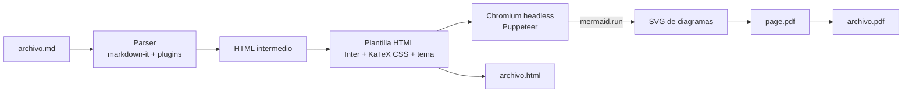

# Plan maestro — MD_reder

> Objetivo: una aplicación de línea de comandos, multiplataforma (Windows y Linux), que
> renderiza archivos Markdown (`.md`) a HTML y PDF exportable, con soporte de
> **ecuaciones (LaTeX)**, **diagramas Mermaid** y tipografía **Inter** (Google Fonts).

---

## 1. Requisitos

### 1.1 Funcionales

| ID   | Requisito                                                                | Prioridad |
| ---- | ------------------------------------------------------------------------ | --------- |
| RF1  | Convertir un `.md` a PDF con un solo comando                             | Must      |
| RF2  | Markdown CommonMark + GFM (tablas, listas de tareas, tachado, autolinks) | Must      |
| RF3  | Ecuaciones en línea `$...$` y en bloque `$$...$$` (LaTeX)                | Must      |
| RF4  | Diagramas Mermaid en bloques ` ```mermaid `                              | Must      |
| RF5  | Tipografía Inter para el texto; monoespaciada para código                | Must      |
| RF6  | Resaltado de sintaxis en bloques de código                               | Should    |
| RF7  | Exportar también a HTML autocontenido                                    | Should    |
| RF8  | Procesar varios archivos o una carpeta completa (batch)                  | Should    |
| RF9  | Opciones de página: tamaño (A4/Letter), márgenes, orientación            | Should    |
| RF10 | Encabezado/pie de página con número de página                            | Should    |
| RF11 | Tabla de contenidos opcional (`--toc`)                                   | Could     |
| RF12 | Modo `--watch` que regenera al guardar                                   | Could     |
| RF13 | Front-matter YAML (título, autor, fecha) y CSS personalizado             | Could     |
| RF14 | Vista previa en el navegador (`preview`)                                 | Could     |

### 1.2 No funcionales

- **Multiplataforma**: Windows 10/11 y Linux (Ubuntu/Debian/Fedora) — x64 (arm64 deseable).
- **Offline**: Inter, KaTeX y Mermaid se empaquetan localmente; no requiere internet en tiempo de ejecución.
- **Fidelidad**: el PDF debe verse igual en ambos sistemas (mismas fuentes embebidas).
- **Rendimiento**: < 3 s para un documento típico (10 páginas, 2 diagramas) con navegador ya disponible.
- **Licencias**: solo dependencias permisivas (MIT/Apache/OFL). Inter está bajo SIL OFL 1.1.

---

## 2. Decisiones de arquitectura

### 2.1 Stack elegido: Node.js + TypeScript + Chromium headless

| Alternativa                       | Ecuaciones         | Mermaid            | Fuentes web | Veredicto                                  |
| --------------------------------- | ------------------ | ------------------ | ----------- | ------------------------------------------ |
| **Node + markdown-it + Chromium** | KaTeX ✔            | Nativo (JS) ✔      | ✔           | **Elegida**                                |
| Python + markdown + WeasyPrint    | ✔ (MathML parcial) | ✘ necesita JS/mmdc | ✔           | Descartada                                 |
| Pandoc + LaTeX                    | ✔                  | ✘ filtros externos | Complejo    | Descartada (instalación pesada en Windows) |
| Go/Rust nativo                    | Limitado           | ✘                  | Limitado    | Descartada                                 |

**Razón principal**: Mermaid es una librería JavaScript que necesita un DOM real para
dibujar SVG. Usar Chromium headless (vía Puppeteer) permite renderizar Markdown, KaTeX y
Mermaid en la misma página y luego imprimirla a PDF con `page.pdf()`, obteniendo
máxima fidelidad tipográfica.

### 2.2 Componentes



| Módulo     | Responsabilidad                                                                   | Librerías                                                                                             |
| ---------- | --------------------------------------------------------------------------------- | ----------------------------------------------------------------------------------------------------- |
| `cli`      | Parseo de argumentos, ayuda, códigos de salida                                    | `commander`                                                                                           |
| `config`   | Fusionar opciones: CLI > front-matter > archivo `mdrender.config.json` > defaults | `yaml`                                                                                                |
| `markdown` | MD → HTML: GFM, anclas, TOC, footnotes, resaltado                                 | `markdown-it`, `markdown-it-anchor`, `markdown-it-footnote`, `markdown-it-task-lists`, `highlight.js` |
| `math`     | `$...$` / `$$...$$` → HTML KaTeX (renderizado en servidor, sin JS)                | `katex` (plugin propio con número de línea en errores)                                                |
| `mermaid`  | Bloques ` ```mermaid ` → marcador; SVG generado en Chromium y luego incrustado    | `mermaid`                                                                                             |
| `template` | Ensamblar HTML final, inyectar CSS (Inter, KaTeX, tema), assets inline            | —                                                                                                     |
| `fonts`    | Inter 4 estática (woff2) + JetBrains Mono para código, incrustadas como data URI  | `inter-ui`, `@fontsource/jetbrains-mono`                                                              |
| `browser`  | Localizar/lanzar Chrome, Edge o Chromium; descarga opcional                       | `puppeteer-core`, `@puppeteer/browsers`                                                               |
| `pdf`      | Esperar a Mermaid y fuentes, `page.pdf()` con encabezado/pie                      | `puppeteer-core`                                                                                      |
| `watch`    | Regenerar al cambiar archivos                                                     | `chokidar`                                                                                            |

### 2.3 Estrategia de navegador (clave para Windows/Linux)

1. Opción `--browser <ruta>` o variable `MDRENDER_BROWSER`.
2. Detección automática de navegadores instalados:
   - **Windows**: Microsoft Edge (siempre presente en Win 10/11) y Google Chrome.
   - **Linux**: `google-chrome`, `chromium`, `chromium-browser`, `microsoft-edge`.
3. Si no se encuentra ninguno: `mdrender setup` descarga _Chrome Headless Shell_ a la caché
   del usuario (`%LOCALAPPDATA%\mdrender` / `~/.cache/mdrender`).

Así el ejecutable se mantiene liviano y no obliga a descargar ~150 MB si ya existe un navegador.

### 2.4 Tipografía

- Texto: **Inter 4** (la misma familia que sirve Google Fonts, SIL OFL 1.1), tomada del
  paquete oficial del autor (`inter-ui`) en pesos **estáticos** 400, 600 y 700 (+ itálicas).
  - _Por qué estáticos_: Chromium incrusta las fuentes variables en el PDF como fuentes
    Type 3 (peor calidad en algunos visores); las estáticas se incrustan como TrueType.
  - _Por qué `inter-ui` y no Fontsource_: los subconjuntos de Google Fonts omiten símbolos
    como flechas (`→`), que caían a fuentes del sistema (DejaVu) y variaban entre SO.
- Código: **JetBrains Mono** (OFL, `@fontsource/jetbrains-mono`) — Inter no es monoespaciada;
  Inter queda como respaldo para símbolos que la fuente de código no tenga.
- Ecuaciones: fuentes KaTeX (necesarias para notación matemática correcta).
- Mermaid: configurado con `themeVariables.fontFamily = "Inter"` para coherencia visual.
- Las fuentes se incrustan como `@font-face` locales; Chromium las embebe en el PDF.

---

## 3. Interfaz de línea de comandos (diseño)

```text
mdrender <entrada...> [opciones]

  -o, --output <ruta>       Archivo o carpeta de salida
  -f, --format <pdf|html>   Formato de salida (por defecto: pdf)
      --page-size <A4|Letter|Legal>   (por defecto: A4)
      --margin <valor>      Ej. "20mm" o "15mm 20mm"
      --landscape           Orientación horizontal
      --toc                 Insertar tabla de contenidos
      --theme <light|dark|ruta.css>
      --css <archivo.css>   CSS adicional
      --header <html> / --footer <html>
      --no-page-numbers
      --mermaid-theme <default|neutral|dark|forest>
      --browser <ruta>      Ejecutable de Chrome/Edge/Chromium
  -w, --watch               Regenerar al guardar
  -q, --quiet / -v, --verbose

mdrender setup              Descarga un Chromium headless si no hay navegador
mdrender preview <archivo>  Abre la vista previa HTML en el navegador
```

Códigos de salida: `0` ok · `1` error de uso · `2` error de render (Mermaid/LaTeX) · `3` navegador no encontrado.

---

## 4. Estructura del repositorio (objetivo)

```text
MD_reder/
├── src/
│   ├── cli.ts
│   ├── config.ts
│   ├── markdown/       (parser, plugins, toc)
│   ├── render/         (template, html, pdf)
│   ├── browser/        (detección y lanzamiento)
│   └── assets/         (tema CSS, plantilla HTML)
├── tests/
│   ├── fixtures/       (md de ejemplo: math, mermaid, tablas, código)
│   └── *.test.ts
├── examples/           (ejemplo.md + ejemplo.pdf generado)
├── docs/
│   └── PLAN_MAESTRO.md
├── .github/workflows/  (CI matrix windows/ubuntu, releases)
├── package.json
├── tsconfig.json
└── README.md
```

---

## 5. Fases y entregables

### Fase 0 — Fundaciones (½ semana)

- [x] Acceso al repositorio y análisis del alcance
- [x] Plan maestro y README inicial
- [x] Inicializar proyecto Node 22.12+ / TypeScript, ESLint, Prettier, Vitest
- [x] Esqueleto de CLI (`commander`): `--help`, `--version`, validación de entrada, códigos de salida
- [x] Cálculo de ruta de salida probado con semántica Windows y POSIX
- [x] CI en GitHub Actions con matriz `windows-latest` + `ubuntu-latest` × Node 22 y 24

**Criterio de salida**: `npm test` pasa en ambos sistemas en CI.

### Fase 1 — MVP: Markdown → PDF (1 semana)

- [x] CLI básica `mdrender archivo.md -o archivo.pdf`
- [x] markdown-it con GFM (tablas, listas de tareas, tachado, autolinks, anclas en títulos)
- [x] Plantilla HTML con **Inter** incrustada y tema claro
- [x] Detección de Chrome/Edge/Chromium/Brave (`--browser`, `MDRENDER_BROWSER`) y generación de PDF
- [x] Imágenes locales con rutas relativas al `.md` (incrustadas como data URI; avisos si faltan)
- [x] Adelantado de Fase 3: salida HTML autocontenida (`--format html`)
- [x] Pruebas de integración: el PDF contiene el texto e Inter/JetBrains Mono incrustadas como TrueType

Notas: en esta fase el JavaScript de la página está deshabilitado (contenido estático); la
Fase 2 lo habilitará de forma controlada para Mermaid. Las imágenes remotas (`https://`) se
dejan tal cual; el bloqueo de red por defecto queda para la Fase 6.

**Criterio de salida**: un `.md` con títulos, tablas, código e imágenes produce un PDF correcto en Windows y Linux.

### Fase 2 — Ecuaciones y Mermaid (1 semana)

- [x] KaTeX (en Node, sin JS en la salida): `$...$`, `$$...$$` (en bloque o en una línea),
      bloques ` ```math `, `aligned`, `matrix`, `cases`; macros `\def`/`\newcommand` válidas en
      todo el documento; reglas de Pandoc para que `$5 y $10` no sean fórmulas
- [x] Mermaid: flowchart, sequence, class, gantt, state, ER, pie, mindmap; `--mermaid-theme`
- [x] Diagramas renderizados antes de imprimir, en una página aparte sin contenido del usuario;
      el SVG resultante se incrusta en el HTML (también en `--format html`, sin scripts)
- [x] Errores claros: `error: archivo.md:LÍNEA: mensaje`, caja roja en el documento, código de salida 2
- [x] Evitar cortes de página dentro de diagramas, ecuaciones, bloques de código y filas de tabla
- [x] KaTeX y sus fuentes solo se incrustan si el documento tiene fórmulas

**Criterio de salida**: fixtures de matemáticas y de los 8 tipos de diagrama renderizan sin errores; pruebas de regresión visual aprobadas.

Resultado: los fixtures `math.md` y `mermaid.md` renderizan sin errores en Windows y Linux.
En lugar de comparar píxeles se verifica el PDF (texto extraído de cada diagrama, fuentes KaTeX
incrustadas como TrueType, ausencia de cajas de error): el antialiasing difiere entre sistemas y
una comparación de píxeles entre Windows y Linux sería frágil. La regresión visual con imágenes
de referencia por sistema queda para la Fase 6.

**Seguridad**: el PDF se imprime con JavaScript deshabilitado, así que un `<script>` dentro del
Markdown nunca se ejecuta. Mermaid corre con `securityLevel: "strict"` en una página propia que
solo recibe el texto de los diagramas.

### Fase 3 — Calidad de documento (1 semana)

- [x] Resaltado de sintaxis (highlight.js, ~35 lenguajes, paleta GitHub) con JetBrains Mono;
      sin autodetección para que el resultado sea estable
- [x] Encabezado/pie con marcadores (`{page}`, `{pages}`, `{title}`, `{author}`, `{date}`) y
      columnas `izq | centro | der`; Inter incrustada también ahí
- [x] Tamaño (A3, A4, A5, Letter, Legal, Tabloid), márgenes estilo CSS y orientación; los
      diagramas Mermaid se dibujan al ancho real de la columna de texto
- [x] Tabla de contenidos `--toc`, `--toc-depth` o marcador `[[toc]]`; marcadores (outline) del
      PDF y PDF etiquetado
- [x] Front matter YAML y `mdrender.config.json` (búsqueda hacia carpetas superiores,
      `--config`, `--no-config`); prioridad CLI > front matter > config > defaults; errores de
      configuración con código 1
- [x] Bloque de título desde el front matter (título, subtítulo, autor, fecha) e idioma
      (`lang`) con textos traducidos (es, en, pt, fr, de)
- [x] CSS adicional `--css` (repetible)
- [x] Salida HTML autocontenida (`--format html`) — adelantada en Fase 1
- [x] Notas al pie y alertas de GitHub (`> [!NOTE]`, `[!TIP]`, `[!IMPORTANT]`, `[!WARNING]`,
      `[!CAUTION]`)

Notas: Chrome no permite números de página dentro de la tabla de contenidos (no soporta
`target-counter`); la navegación se cubre con enlaces y marcadores del PDF. Chrome tampoco
escribe el autor en los metadatos del PDF (solo el título).

### Fase 4 — Productividad (½ semana)

- [x] Procesamiento por lotes: varios archivos, carpetas (recursivo, sin carpetas ocultas ni
      `node_modules`) y patrones `docs/**/*.md` expandidos por la propia app (funcionan en
      Windows); `-o` como carpeta conserva la estructura; un solo navegador para todo el lote;
      se sigue ante errores y el código de salida es el más grave
- [x] `--watch`: reconvierte el archivo cambiado; cambios en configuración, CSS o imágenes
      reconvierten todo; detecta archivos nuevos en carpetas vigiladas
- [x] `mdrender preview <archivo>`: servidor local en 127.0.0.1 con recarga automática
      (Server-Sent Events), `--port`, `--no-open`; los errores se muestran en la página
- [x] Temas: `--theme light|dark|archivo.css`; el oscuro pinta la hoja completa y usa Mermaid
      oscuro salvo que se indique `--mermaid-theme`
- [x] Idioma por defecto: español (`--lang en` para inglés)

### Fase 5 — Distribución (1 semana)

- [x] Paquete npm `@imontene/mdrender` (el nombre `mdrender` ya está tomado en npm; el
      comando sigue siendo `mdrender`): `files`, `exports`, `prepublishOnly`, provenance
- [x] Ejecutables independientes (Node SEA) para `win-x64`, `linux-x64` y `linux-arm64`
      (este último opcional, según disponibilidad de runners ARM): bundle CommonJS con esbuild
      y todos los recursos (fuentes, CSS, Mermaid) como assets SEA; incluyen
      `THIRD-PARTY-NOTICES.txt`
- [x] `mdrender setup`: descarga Chrome Headless Shell (estable) a la caché del usuario
      (`%LOCALAPPDATA%\mdrender`, `~/.cache/mdrender`, `MDRENDER_CACHE_DIR`); no descarga si
      ya hay navegador; la detección lo usa como último recurso
- [x] GitHub Releases automáticos por tag (`v*`) con `SHA256SUMS.txt`; publicación en npm
      si existe el secreto `NPM_TOKEN`
- [x] CI: construye y prueba el ejecutable fuera del proyecto y valida `mdrender setup`
      en Windows y Linux
- [ ] Opcional (pendiente): paquetes `winget`/`scoop` y `.deb`/AppImage

### Fase 6 — Endurecimiento y v1.0 (½ semana)

- [x] Rutas con espacios, Unicode y acentos en carpetas, archivos e imágenes (también
      `` en HTML crudo, que ahora se incrusta)
- [x] Rutas de Windows (`C:\...`) en CI; UNC (`\\servidor\recurso`) probado cuando el
      recurso administrativo está disponible
- [x] Documento grande: 100+ páginas y 50 diagramas en ~10 s
- [x] Seguridad: sin JS del usuario; red bloqueada salvo `--allow-remote` (avisos por cada
      recurso omitido); `file:` siempre bloqueado
- [x] `--quiet` / `--verbose`
- [x] Cobertura ≥ 80 % exigida en CI (88 % de líneas)
- [x] Documentación completa (README, CHANGELOG) y ejemplo en `examples/`
- [x] Versión 1.0.0

Pendiente explícito: regresión visual con imágenes de referencia por sistema. Se mantiene la
verificación estructural del PDF (texto, fuentes, páginas, marcadores), que es estable entre
Windows y Linux.

**Duración estimada total**: ~5–6 semanas de trabajo de una persona.

### Fase 7 — Diagramación compositiva de Mermaid (`--mermaid-layout smart`) (3–4 semanas)

Especificación: [`ESPECIFICACION_MERMAID_LAYOUT.md`](ESPECIFICACION_MERMAID_LAYOUT.md) (origen:
[`IDEACION_DIAGRAMACION_MERMAID.md`](IDEACION_DIAGRAMACION_MERMAID.md)). Un modo opcional que
reinterpreta la topología de los diagramas de flujo (espina dorsal, ciclos, hubs, subgrafos,
nodos transversales) y los coloca con motores propios; **Mermaid sigue dibujando**, mediante
algoritmos de diagramación propios registrados con `mermaid.registerLayoutLoaders`. El modo
`classic` (el actual) sigue por defecto y no cambia. Solo `flowchart`/`graph`; el modo `ai`
queda aplazado (paso 7.9).

Tamaños: S ≈ 1–2 días, M ≈ 3–4 días, L ≈ 1 semana.

- [x] **7.1 Prueba de concepto (S).** Script desechable en `docs/prototipos/mermaid_layout/`
      que registra `mdr-measure` y `mdr-place` sobre Mermaid 12.1.0 y confirma, con los 17
      diagramas de flujo de `tests/fixtures/mermaid-autofit.md`:
  - que `insertNode` da tamaños estables para todas sus formas y que `mdr-place` los dibuja
    donde dice el plan, con `finishDiagram` intacto (bandas de subgrafo incluidas);
  - aristas con etiqueta, flechas punteadas y gruesas, marcadores, y aristas entre subgrafos
    de primer nivel recortadas contra su borde (`clusterDb`, caso 8);
  - interpolación `rounded` para rutas ortogonales y si se puede elegir por arista
    (`edge.curve`);
  - si Mermaid respeta un tamaño de nodo dado (para igualar hermanos más adelante).

  Salida: una nota en la especificación con lo confirmado y lo descartado, y los ajustes a los
  pasos siguientes. Si el contrato no se sostiene, la fase se replantea aquí, antes de escribir
  el resto.

  Resultado: **el contrato se sostiene** (§12 de la especificación;
  [`resultados.md`](prototipos/mermaid_layout/resultados.md)). En 20 casos, Mermaid dibuja nodos,
  subgrafos, aristas, flechas y etiquetas donde dice el plan, con el acabado intacto y sin
  imágenes en el PDF; la serpentina reduce un 47–53 % el alto de las cadenas a la misma escala.
  Reglas nuevas del plan: aristas de al menos 3 puntos y posición de etiquetas calculada por el
  router. Descartado: igualar el tamaño de nodos hermanos.

  Segunda iteración con cinco diagramas reales del autor (§12.5): con motores mínimos de ELK y
  de anillo, `smart` solo mejora uno; en los demás, el límite es el tamaño de las cajas y de
  los rombos, no la topología. Quedan dos decisiones para antes del paso 7.5: el piso para
  arquetipos que cambian la forma (`flywheel`) y si se ofrecen rombos de decisión compactos.

- [x] **7.2 Opción y dependencias (S).** `--mermaid-layout <classic|smart>` en `options.ts`,
      `cli.ts` (también en `preview`), `convert.ts` y `doctor.ts` (línea en `Settings`); pruebas
      en `options.test.ts`, `cli.test.ts` y `doctor.test.ts`. `elkjs` como dependencia directa.
      Versión exacta de `mermaid` en `package.json` (hoy `^12.1.0`). En esta etapa `smart` se
      comporta igual que `classic`.

  Hecho: la opción se acepta en la línea de comandos (también en `preview`), en el front matter
  y en `mdrender.config.json`; rechaza otros valores, sugiere ante errores de tipeo y aparece en
  `doctor`. Una prueba verifica que `smart` produce el mismo HTML que `classic`. Mermaid queda
  fijo en 12.1.0 y `elkjs` (0.9.3) pasa a dependencia directa. Al probarlo apareció un problema
  previo: los diagramas de clases no salen iguales en dos conversiones, porque Mermaid 12 dibuja
  algunas líneas con una semilla al azar.

- [ ] **7.3 Medición y dibujo (M).** `mermaid-compose/types.ts`, `directives.ts`,
      `page-layouts.ts` (`mdr-measure` y `mdr-place` como texto fuente, con las reglas del §12.2
      de la especificación) e `index.ts` con un motor provisional trivial; configuración de
      Mermaid exportada y compartida con `classic`; bifurcación en `render/mermaid.ts` con vuelta a `classic` ante
      los casos del §4.2 de la especificación o cualquier error;
      `tests/mermaid-layout-contract.test.ts`.
- [ ] **7.4 Analizador (M).** `analyze.ts`: Tarjan, aristas de retorno, espina dorsal,
      `sidecar` (con la exclusión de vértices de articulación), polaridad de decisiones,
      elección de arquetipo y pistas `%% @…`; `tests/mermaid-analyze.test.ts` con cada
      arquetipo y los casos del corpus.
- [ ] **7.5 Motores no jerárquicos (L).** `engines/serpentine.ts`, `flywheel.ts`, `hub.ts`,
      `bento.ts` (también subgrafos sin aristas entre sí, en retícula) y `polish.ts` (retícula de
      8 px); `tests/mermaid-engines.test.ts` (sin solapes, anchos iguales en `bento`, alas
      equilibradas en `hub`). De la calibración (§5.4): serpentina solo para cadenas de 8 pasos o
      más y con todas las filas de izquierda a derecha (retorno de carro); el anillo queda
      confirmado para ciclos.
- [ ] **7.6 Motor general y rutas (L).** `engines/layered.ts` con `elkjs` en Node (puertos
      fijos, zócalo o carril para los `sidecar`) y `routing.ts` (rutas ortogonales, arcos,
      retornos por canal lateral, posición de las etiquetas de arista sin choques). De la
      calibración (§5.4): las flechas deben tocar los rombos y demás formas no rectangulares, y
      cada padre debe quedar centrado sobre sus hijos, con la raíz centrada en el dibujo.
- [ ] **7.7 Criterio de elección (M).** El mejor entre `classic` y `smart` (§5.3 y §5.4 de la
      especificación): `score.ts` con las medidas sobre el SVG final, condiciones obligatorias,
      candidatos (`classic`, `classic` transpuesto, motores `smart` por ancho de ajuste y eje
      según `--mermaid-autofit` y `--mermaid-flip`), directiva `%% @layout:`, calibración de
      pesos y margen con los votos de la galería ciega (meta: 75 % de coincidencia en los pares
      reservados) y trazas de `--verbose` (`Mermaid smart layout: …`, `kept classic (…)`).
  - [x] Galería ciega para recoger votos desde ya, regenerable a medida que cambian los motores
        (`docs/prototipos/galeria_ciega/`): primera versión publicada con 49 pares (§5.4).
  - [x] Primera calibración con 49 votos (§5.4): regla escalonada (condiciones obligatorias,
        luego el más compacto, luego el mejor centrado), 71 % de coincidencia dejando cada par
        fuera; `MIN_SCALE` baja a 0,5.
  - [ ] Recalibrar con una galería nueva cuando estén los motores de 7.5 y 7.6 (meta: 75 %).
- [ ] **7.8 Integración y entrega (M).** `tests/fixtures/mermaid-smart.md` (serpentina, ciclo,
      hub, bento, transversales, casos que vuelven a `classic`);
      `tests/mermaid-smart.test.ts` en `antigravity`, `antigravity-dark`, `academic_basic` y
      `tech_magazine`; `bench:mermaid` con comparación `classic`/`smart` y tiempos (criterio:
      50 diagramas en `smart` ≤ 2 × `classic`); README (opción y ejemplo), CHANGELOG, ejemplo en
      `examples/`; `npm run check` y `npm run build:exe` en Windows y Linux (CI); versión menor
      nueva.
- [ ] **7.9 Evaluación de cierre (S).** Comparar `classic` y `smart` sobre el corpus (galería de
      PDF) y decidir, dejando la decisión escrita en la especificación:
  - si basta con la interpretación determinista o si se aborda alguna opción con IA (el antiguo
    modo `ai`: proveedor, modelo, autorización de red separada de `--allow-remote`,
    privacidad);
  - si `smart` pasa a ser el modo por defecto de algún tema;
  - el orden del resto del trabajo aplazado (§10 de la especificación): diagramas de estados,
    aristas a subgrafos anidados, puentes en cruces, igualar nodos hermanos, y el marco de
    `tech_magazine` en ambos modos.

**Criterio de salida**: los criterios de aceptación del §7.2 de la especificación, y la
decisión del paso 7.9 registrada.

---

## 6. Estrategia de pruebas

| Tipo             | Qué se valida                                                        | Herramienta                   |
| ---------------- | -------------------------------------------------------------------- | ----------------------------- |
| Unitarias        | Parser MD → HTML, plugins, config                                    | Vitest                        |
| Snapshot HTML    | HTML generado estable para cada fixture                              | Vitest snapshots              |
| Integración PDF  | El PDF existe, nº de páginas, texto extraíble, fuente Inter embebida | `pdf-parse` / `pdfjs-dist`    |
| Regresión visual | PDF → PNG comparado con referencia                                   | `pdf-to-img` + `pixelmatch`   |
| E2E CLI          | Códigos de salida, opciones, rutas en Windows y Linux                | Vitest + `execa` en CI matrix |

---

## 7. Riesgos y mitigaciones

| Riesgo                                           | Impacto | Mitigación                                                     |
| ------------------------------------------------ | ------- | -------------------------------------------------------------- |
| No hay navegador Chromium en la máquina          | Alto    | Detección de Edge (siempre en Windows) + `mdrender setup`      |
| Ejecutable demasiado grande                      | Medio   | No empaquetar Chromium; usar navegador del sistema             |
| Diagramas Mermaid cortados entre páginas         | Medio   | `break-inside: avoid`, escalado de SVG anchos                  |
| Ecuaciones con macros no soportadas por KaTeX    | Bajo    | Mensaje claro; opción `--katex-macros`                         |
| Diferencias de fuentes entre SO                  | Medio   | Fuentes empaquetadas, nunca depender de fuentes del sistema    |
| Cambios de API en Mermaid                        | Bajo    | Versión fijada + pruebas de regresión visual                   |
| Cambios en la API de layouts de Mermaid (Fase 7) | Medio   | Versión exacta, pruebas de contrato y vuelta a `classic`       |
| Markdown malicioso (HTML/JS embebido)            | Medio   | Sanitizar HTML, bloquear red y scripts del usuario por defecto |

---

## 8. Definición de "terminado" para v1.0

- `mdrender doc.md` produce un PDF con Inter, ecuaciones y diagramas Mermaid correctos.
- Funciona igual en Windows 10/11 y Ubuntu 22.04+ (verificado en CI).
- Instalación en un paso (npm o ejecutable descargable).
- README con ejemplos, y cobertura de pruebas ≥ 80 % en el núcleo.
