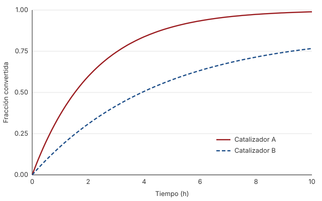

<header class="oa-front">

Ciencia AbiertaArtículo de investigación

<aside class="oa-side">

<svg viewBox="0 0 16 22" width="9" height="12" aria-hidden="true"><path d="M3 10V6.5a5 5 0 0 1 9.6-2" fill="none" stroke="currentColor" stroke-width="2.4" stroke-linecap="round"/><circle cx="8" cy="15" r="5.5" fill="none" stroke="currentColor" stroke-width="2.4"/><circle cx="8" cy="15" r="1.6" fill="currentColor"/></svg> Acceso abierto

CitaPérez A, Gómez L, Ruiz M. Cinética de conversión catalítica a baja temperatura. <em>Ciencia Abierta</em>. 2026;4:e0042.

EditoraCarla Soto, Universidad de Ejemplo

Recibido2 de septiembre de 2026 Aceptado30 de octubre de 2026 Publicado22 de noviembre de 2026

Licencia© 2026 Pérez et al. Artículo de acceso abierto bajo la licencia Creative Commons Atribución 4.0 (CC BY 4.0), que permite su uso, distribución y reproducción citando a los autores.

Correspondenciaana.perez@ejemplo.org

DOI10.0000/ejemplo.2026.0042

</aside>

<h1 class="oa-title">Cinética de conversión catalítica a baja temperatura</h1>

Ana Pérez1* ORCID, Luis Gómez1,2, Marta Ruiz2

<ol class="oa-affiliations"><li>1Departamento de Química, Universidad de Ejemplo, Santiago, Chile.</li><li>2Instituto de Materiales Avanzados, Valparaíso, Chile.</li><li>*Autora de correspondencia.</li></ol>
<section class="oa-abstract">

Resumen

<strong>Antecedentes:</strong> elegir un catalizador para procesos a baja temperatura suele exigir largas campañas de ensayo.

<strong>Métodos:</strong> medimos la conversión de un sustrato modelo con dos catalizadores heterogéneos entre 20 y 60 °C y ajustamos un modelo de primer orden.

<strong>Resultados:</strong> el catalizador A alcanza el 90 % de conversión en menos de la mitad del tiempo que el B; el modelo reproduce todas las curvas con un error menor al 2 %.

<strong>Conclusiones:</strong> un modelo de dos parámetros basta para elegir el catalizador según la ventana de operación.

</section>

<strong>Palabras clave:</strong> catálisis heterogénea; cinética; modelos de primer orden

</header>

## Introducción

La conversión catalítica a baja temperatura es clave para procesos que no toleran calor, como
la síntesis de compuestos sensibles o el tratamiento de efluentes [1, 2]. Elegir un catalizador
suele requerir largas campañas de ensayo; un modelo cinético simple acorta ese camino y permite
comparar candidatos con pocos experimentos.

En este trabajo comparamos dos catalizadores comerciales y mostramos que un modelo de primer
orden, con una constante de velocidad que sigue la ley de Arrhenius, basta para describir la
conversión en todo el rango estudiado. Esto contrasta con trabajos anteriores que proponían
modelos de orden fraccionario para sistemas parecidos [3].

## Modelo cinético

### Conversión en el tiempo

Suponemos que la velocidad de conversión es proporcional a la fracción de sustrato que aún no
reacciona. Integrando, la fracción convertida $X(t)$ resulta

$$
X(t) = X_\infty \left(1 - e^{-k t}\right),
$$

donde $X_\infty$ es la conversión final y $k$ la constante de velocidad.

### Dependencia con la temperatura

La constante de velocidad sigue la ley de Arrhenius,

$$
k(T) = A\, e^{-E_a / R T},
$$

de modo que dos mediciones a temperaturas distintas bastan para estimar la energía de
activación $E_a$:

$$
E_a = \frac{R \ln (k_2 / k_1)}{1/T_1 - 1/T_2}.
$$

## Resultados

La fracción convertida crece de forma monótona con el tiempo y se aproxima a uno para ambos
catalizadores (Figura 1). El catalizador A es claramente más rápido: llega al 50 % de
conversión en 1,5 h, frente a 3,1 h del B.

<figure class="fig">

<figcaption>Conversión en función del tiempo a 40 °C. La línea continua corresponde al
catalizador A y la discontinua al B; cada curva es el promedio de tres ensayos.</figcaption>
</figure>

Los parámetros ajustados con la ecuación (1) aparecen en la Tabla 1. La menor energía de
activación del catalizador A explica su ventaja, que además crece al bajar la temperatura.

Parámetros del modelo ajustados para cada catalizador.

| Catalizador | $X_\infty$ | $k$ a 40 °C (h⁻¹) | $E_a$ (kJ/mol) | $R^2$ |
| :---------- | ---------: | ----------------: | -------------: | ----: |
| A           |       1,00 |              0,45 |           38,2 | 0,998 |
| B           |       0,86 |              0,22 |           44,7 | 0,995 |

## Discusión

El modelo de primer orden describe bien ambos sistemas, sin necesidad de términos adicionales.
La diferencia en $X_\infty$ indica que el mecanismo de desactivación, y no solo la velocidad,
debe considerarse al elegir un catalizador [2].

## Conclusiones

Un modelo de dos parámetros reproduce la conversión de ambos catalizadores con un error menor
al 2 %. Para procesos continuos conviene el catalizador A; para operaciones por lotes cortas,
la diferencia es menor y el costo puede decidir.

## Contribuciones de los autores

A. P. diseñó los experimentos y escribió el manuscrito; L. G. realizó las mediciones; M. R.
desarrolló el modelo. Todos los autores revisaron y aprobaron la versión final.

## Financiamiento

Este trabajo fue financiado por un fondo de investigación de ejemplo (proyecto 0000).

## Disponibilidad de datos

Los datos y el código del ajuste están disponibles en un repositorio público de ejemplo.

## Conflictos de interés

Los autores declaran no tener conflictos de interés.

## Referencias

1. Autor A, Autor B. Título de un artículo citado como ejemplo. Revista de Ejemplo. 2024;12(3):45–56.
2. Autor C. Título de un libro de ejemplo. 2.ª ed. Ciudad: Editorial de Ejemplo; 2023.
3. Autor D, Autor E, Autor F. Otro artículo citado como ejemplo. Revista de Ejemplo. 2022;10(1):1–12.

