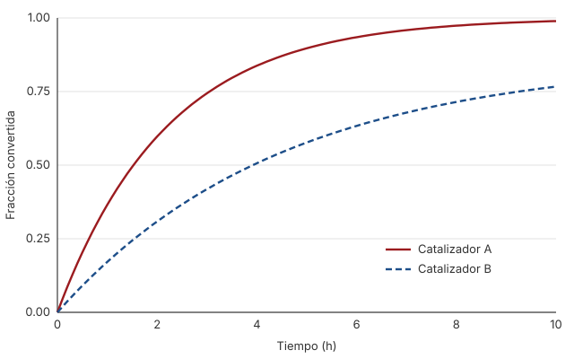
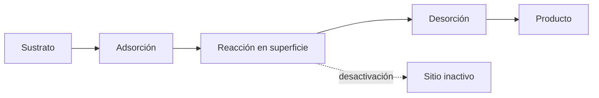

## Introducción

La conversión catalítica a baja temperatura es clave para procesos que no toleran calor,
como la síntesis de compuestos sensibles o el tratamiento de efluentes. Elegir un catalizador
suele requerir largas campañas de ensayo; un modelo cinético simple acorta ese camino y
permite comparar candidatos con pocos experimentos[^1].

En este trabajo comparamos dos catalizadores comerciales y mostramos que un modelo de primer
orden, con una constante de velocidad que sigue la ley de Arrhenius, basta para describir
la conversión en todo el rango estudiado. Esto contrasta con trabajos anteriores que
proponían modelos de orden fraccionario para sistemas parecidos.

## Resultados

La fracción convertida $X(t)$ crece de forma monótona con el tiempo y se aproxima a uno para
ambos catalizadores (Fig. 1). El catalizador A es claramente más rápido: llega al 50 % de
conversión en 1,5 h, frente a 3,1 h del B.

Ajustamos cada curva al modelo

$$
X(t) = X_\infty \left(1 - e^{-k t}\right), \qquad k = A\, e^{-E_a / R T},
$$

donde $X_\infty$ es la conversión final, $k$ la constante de velocidad y $E_a$ la energía de
activación. Los parámetros ajustados aparecen en la Tabla 1.

| Catalizador | $X_\infty$ | $k$ a 40 °C (h⁻¹) | $E_a$ (kJ/mol) | $R^2$ |
| :---------- | ---------: | ----------------: | -------------: | ----: |
| A           |       1,00 |              0,45 |           38,2 | 0,998 |
| B           |       0,86 |              0,22 |           44,7 | 0,995 |

La menor energía de activación del catalizador A explica su ventaja, que además crece al bajar
la temperatura. El catalizador B, en cambio, no supera el 86 % de conversión, lo que sugiere
una desactivación parcial de sus sitios activos.

## Discusión

El modelo de primer orden describe bien ambos sistemas, sin necesidad de términos adicionales.
La diferencia en $X_\infty$ indica que el mecanismo de desactivación, y no solo la velocidad,
debe considerarse al elegir un catalizador.

Para procesos continuos conviene el catalizador A; para operaciones por lotes cortas, la
diferencia es menor y el costo puede decidir.

## Métodos

Los ensayos se hicieron en un reactor de vidrio de 250 mL con agitación constante. La
conversión se midió por cromatografía cada 15 minutos, y cada condición se repitió tres veces.

[^1]: Los datos y el código del ajuste están disponibles a pedido.
