# Banco sintético de autoajuste Mermaid

Veinte diagramas que reproducen los casos del estudio de autoajuste: cadenas horizontales,
diagramas verticales con subgrafos horizontales, etiquetas largas, diagramas que no caben en la
página, y tipos a los que el autoajuste no se aplica.

## 1. Cadena LR de 8 pasos

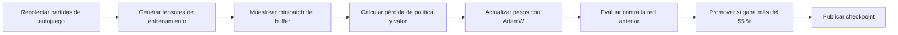

## 2. Cadena LR de 5 pasos con etiquetas medianas

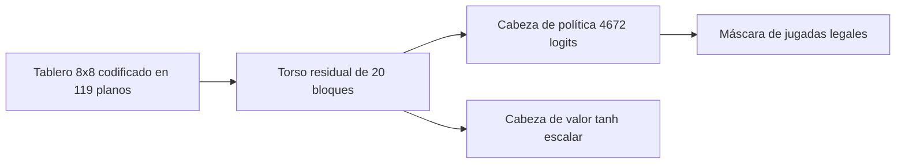

## 3. Cadena LR con decisión

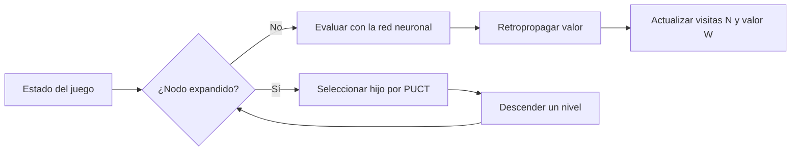

## 4. Cadena graph LR de 6 pasos

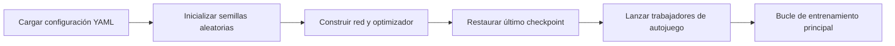

## 5. Cadena RL de 6 pasos

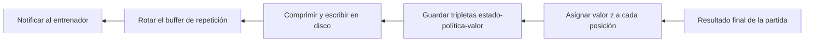

## 6. Cadena LR de 7 pasos con etiquetas cortas

## 7. TD con subgrafos en paralelo

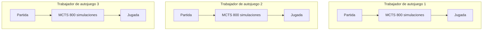

## 8. TB con subgrafos horizontales

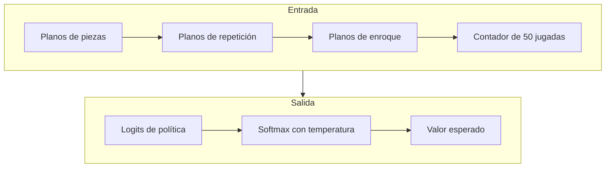

## 9. TD ancho de varias ramas

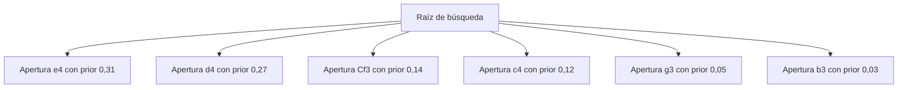

## 10. TD con etiquetas largas

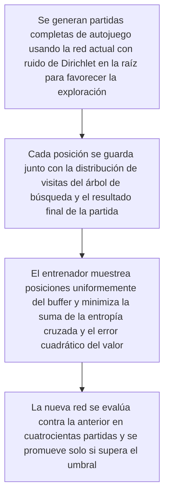

## 11. TD de comparación de arquitecturas

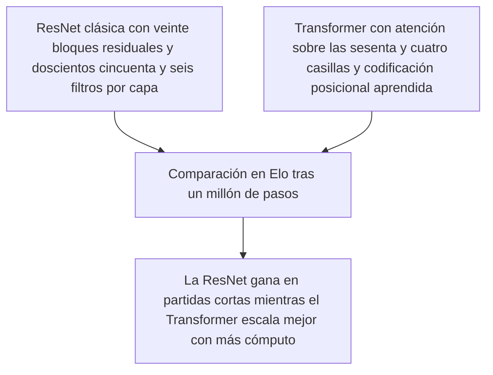

## 12. TD de Gumbel con etiquetas largas

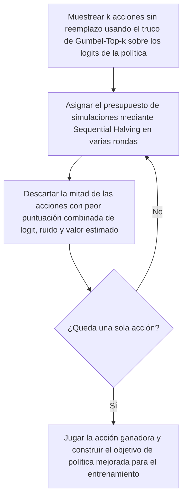

## 13. TD corto con explicación

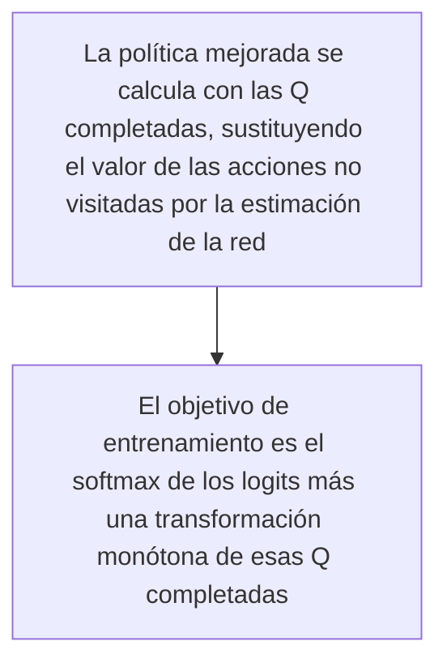

## 14. TD de cabezas de red

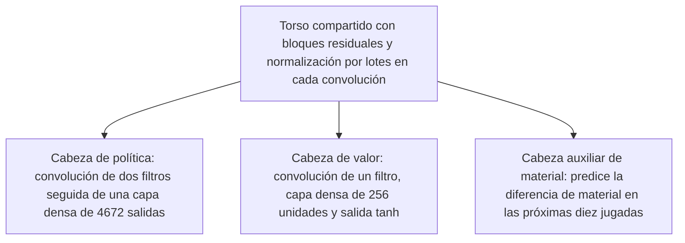

## 15. Arquitectura general grande

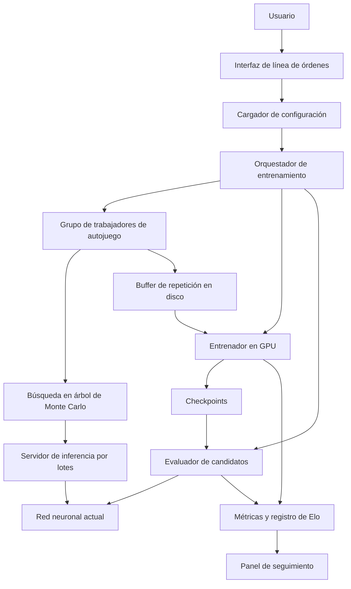

## 16. Flujo de datos con etiquetas de código

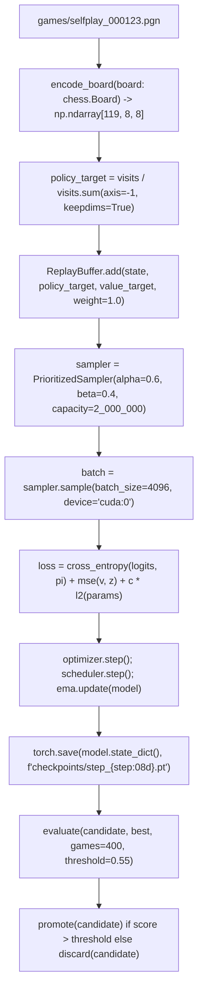

## 17. Representación del tablero

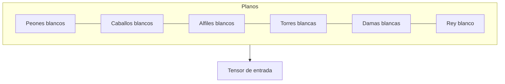

## 18. Tipo no aplicable: torta

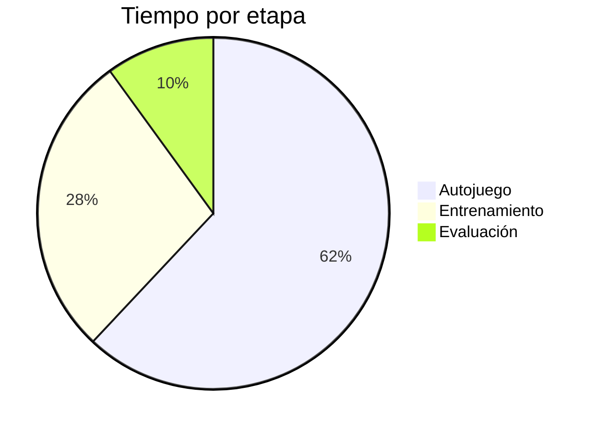

## 19. Tipo no aplicable: secuencia

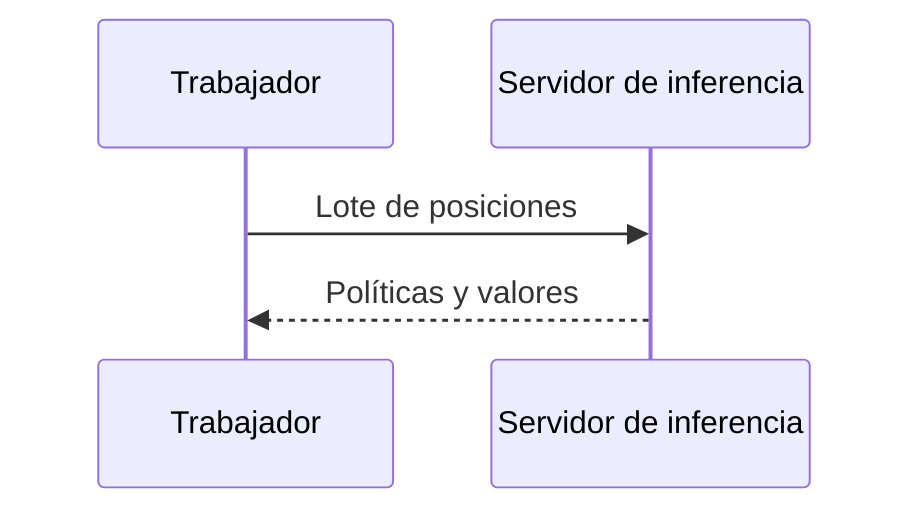

## 20. Configuración del autor

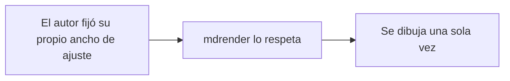
